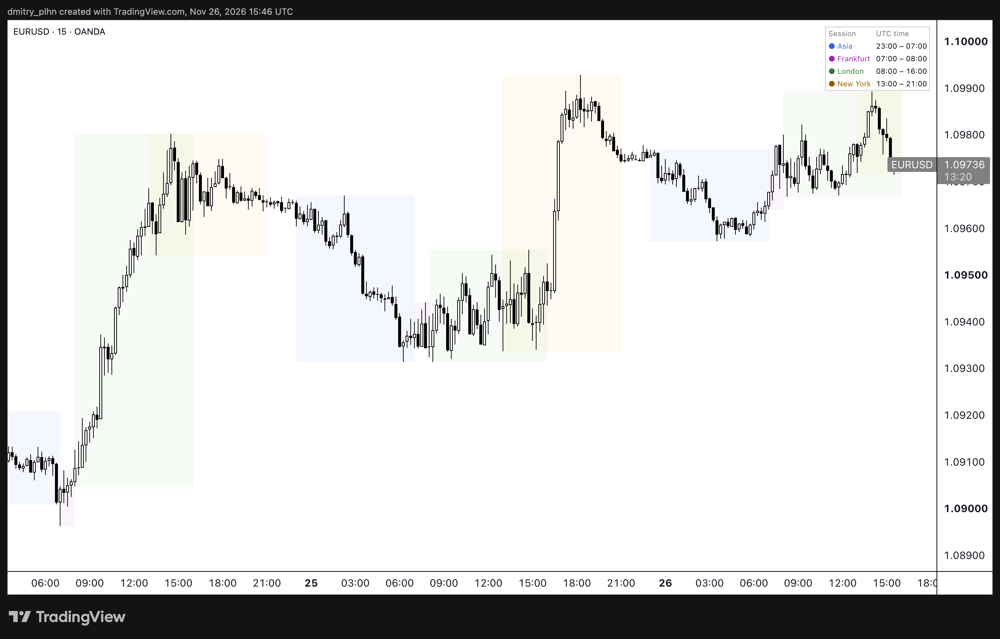
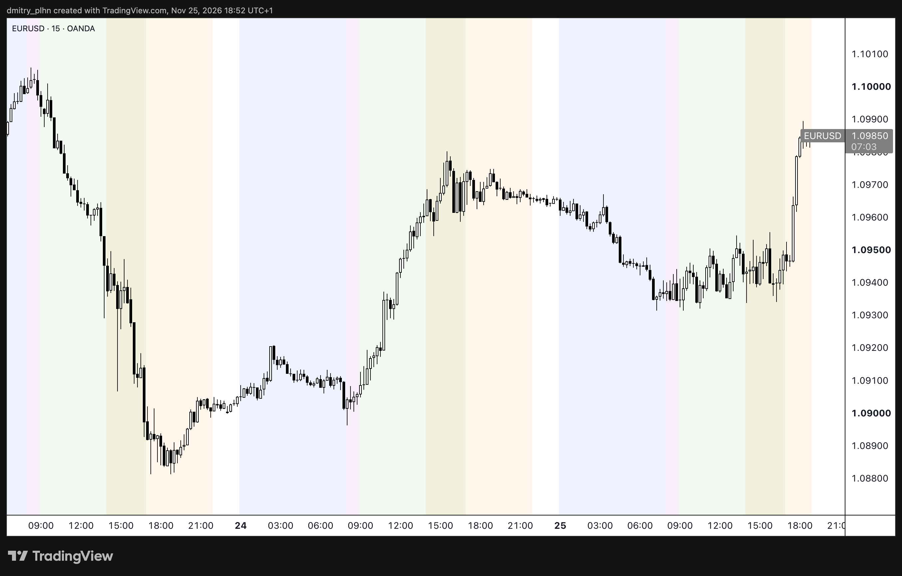
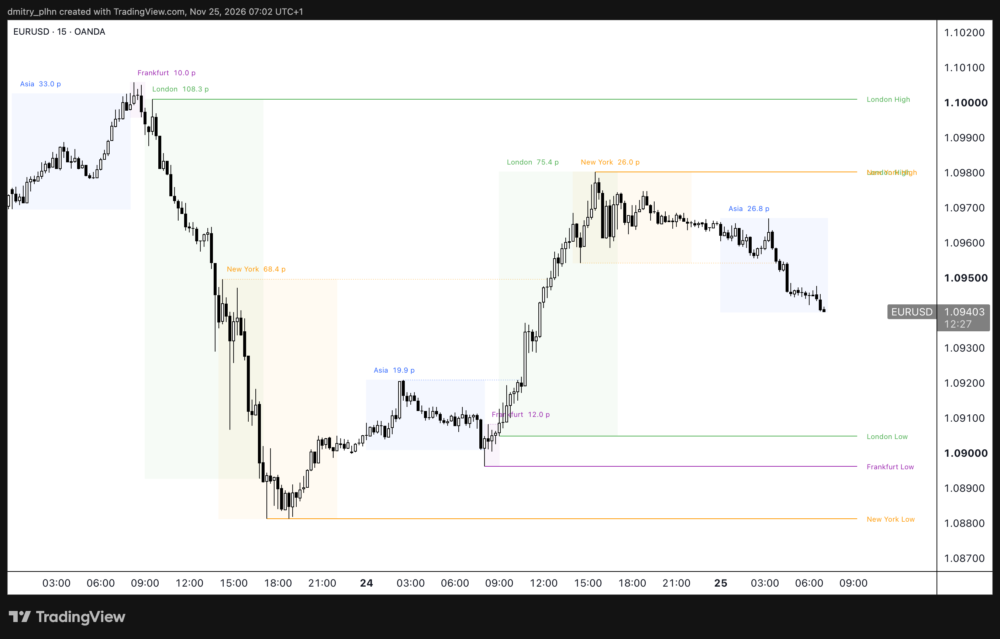
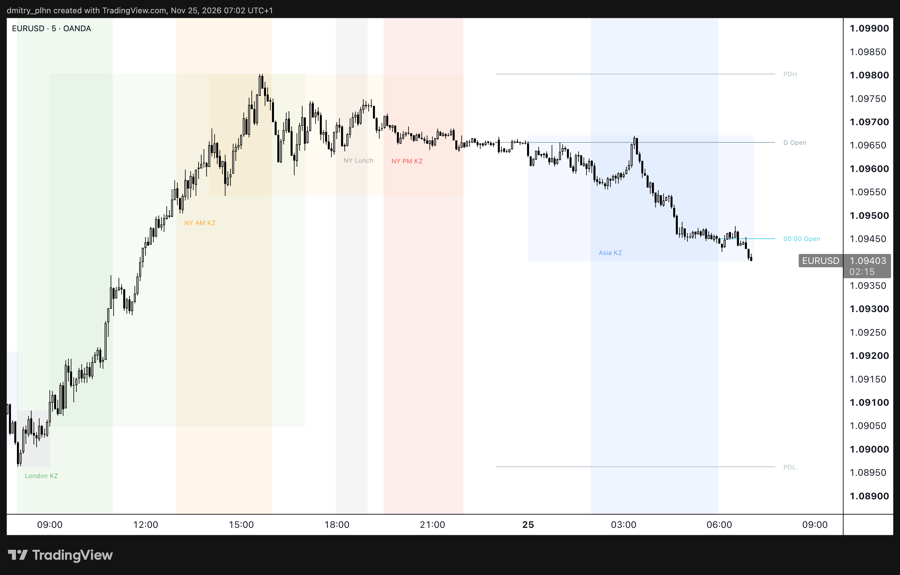
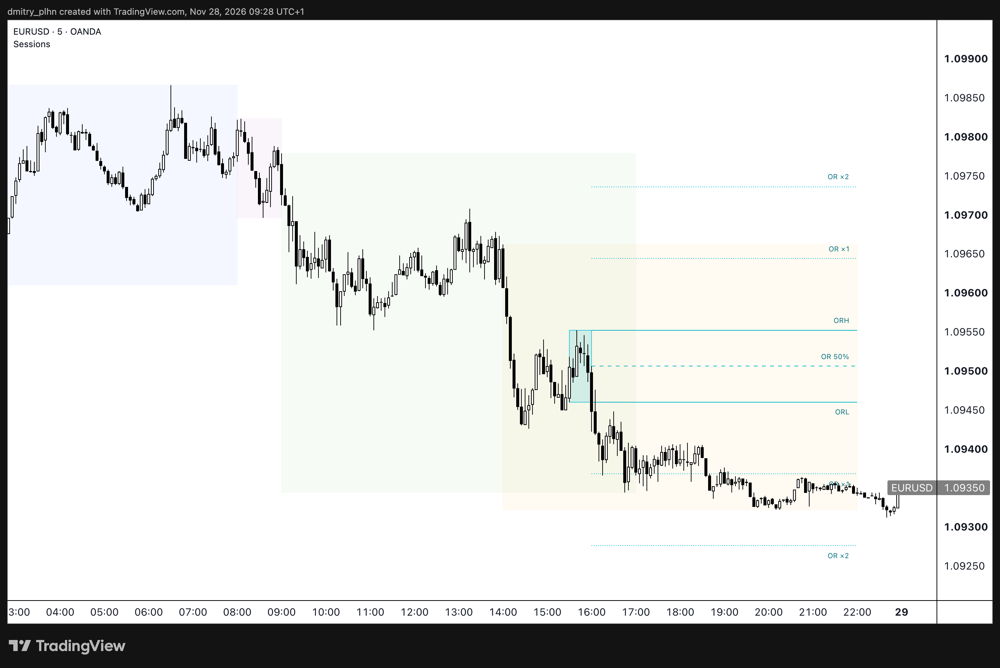
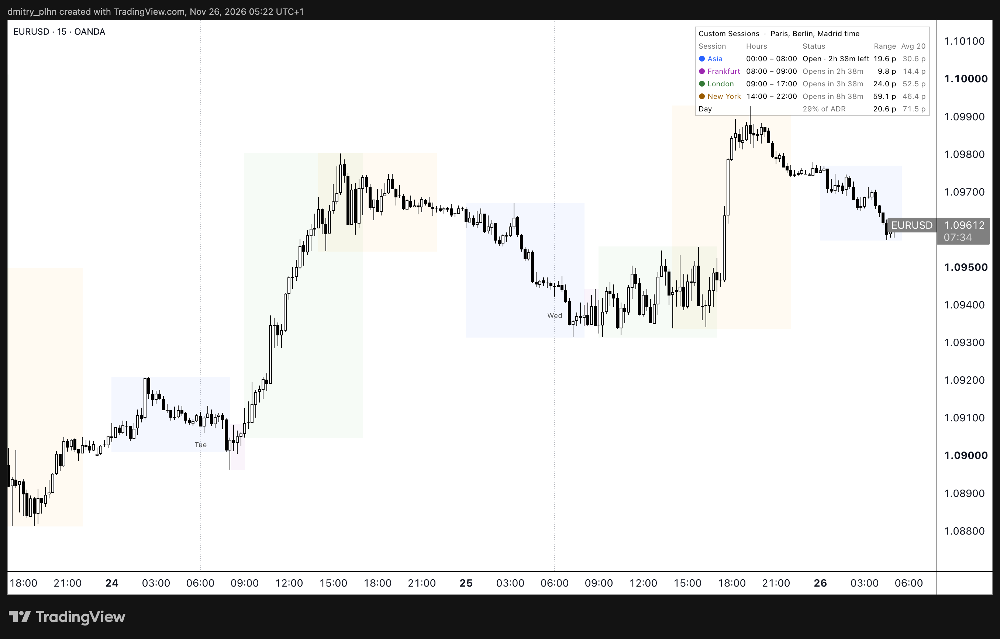
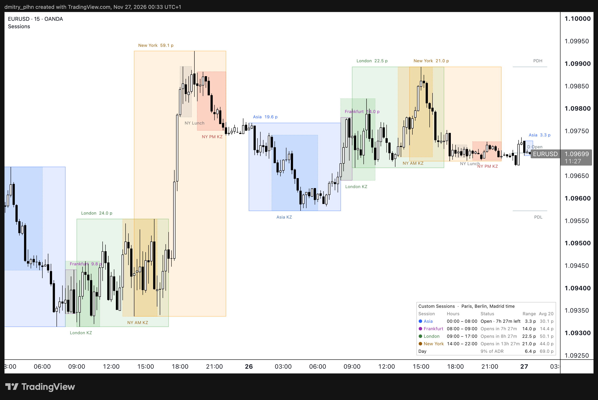

# Custom Sessions Indicator

**Sessions, killzones, niveaux de liquidité, prix d'ouverture, opening range, initial balance et tableau de bord — un seul indicateur TradingView, entièrement configurable.**

[English](README.md) · [Русский](README.ru.md) · **Français**

[**Ouvrir sur TradingView**](https://www.tradingview.com/script/aK5XyDPb-Sessions-Killzones-Opening-Range-and-Dashboard-with-Auto-DST/) · [Dernière version](https://github.com/DmytroPalahin/sessions-indicator/releases/latest) · [Paramètres](docs/SETTINGS.md) · [FAQ](docs/FAQ.md) · [Journal des modifications](CHANGELOG.md) · [Signaler un bug](https://github.com/DmytroPalahin/sessions-indicator/issues/new/choose)

Paramètres par défaut sur EURUSD, 15 minutes : Asia, Frankfurt, London et New York.

---

## De quoi s'agit-il

Un seul indicateur Pine Script v6 qui découpe la journée de trading sur votre graphique. Dès l'installation, il
dessine les sessions Asia, Frankfurt, London et New York sous forme de boîtes de couleur douces. Tout le reste
s'active d'une case à cocher et reste désactivé par défaut : le graphique reste propre tant que vous n'en demandez
pas plus.

On le cherche sous différents noms : indicateur de sessions pour TradingView, plus hauts et plus bas de session,
range asiatique (Asian range), killzones ICT, plus haut et plus bas de la veille, cassure du range d'ouverture
(opening range breakout), balance initiale de la première heure (initial balance). Il réunit tout cela dans un seul
script, et les horaires des sessions suivent d'eux-mêmes le passage à l'heure d'été.

| № | Module | Ce que vous obtenez |
| --- | -------- | -------------- |
| ① | **General** | Profondeur de l'historique, limite d'unité de temps et votre propre fuseau horaire, pour que le tableau affiche chaque session à votre heure |
| ② | **Sessions** | 5 emplacements : Asia, Frankfurt, London, New York et un de réserve, chacun à l'heure locale de sa ville. Le nom, les heures, la ville et la couleur se modifient |
| ③ | **Session display** | Boîte, fond, les deux ou masqué · étiquette avec le nom et l'amplitude · ligne d'ouverture · médiane à 50 % |
| ④ | **Session high / low levels** | Les plus hauts et les plus bas restent sur le graphique jusqu'à ce que le prix les traverse |
| ⑤ | **Killzones** | 5 emplacements de plus avec leur propre apparence, préréglés sur les fenêtres habituelles Asia / London / New York |
| ⑥ | **Previous day / week / month** | PDH/PDL, PWH/PWL, PMH/PML |
| ⑦ | **Opening prices** | Ouverture du jour, de la semaine, du mois, de minuit et d'une heure de votre choix |
| ⑧ | **Opening range et initial balance** | Un opening range et deux initial balances — la première heure de Francfort et celle de New York — chacun avec son interrupteur : boîte du range, lignes prolongées avec étiquettes, médiane, projections, taille du range par rapport à sa moyenne, marqueurs de cassure en option |
| ⑨ | **Time tools** | Séparateurs de jours et étiquettes des jours de la semaine |
| ⑩ | **Dashboard** | Quelle session est ouverte, ses heures à votre propre heure, temps restant ou temps avant l'ouverture, amplitude en cours face à sa moyenne, amplitude du jour face à l'ADR |
| ⑪ | **Style** | Taille du texte, style et épaisseur des lignes, options des étiquettes, filtre des niveaux éloignés |

## Captures d'écran

Chaque image ci-dessous montre le même indicateur avec quelques cases cochées. Les légendes indiquent lesquelles.

<table>
<tr>
<td width="50%" valign="top">

<b>Sessions sur toute la hauteur</b> 
③ <i>Style</i> = <code>Background</code>
</td>
<td width="50%" valign="top">

<b>Étiquettes et niveaux des sessions</b> 
③ <i>Label</i> = <code>Name + range</code> · ④ <i>Extend session high / low until broken</i>
</td>
</tr>
<tr>
<td width="50%" valign="top">

<b>Killzones, veille et prix d'ouverture</b> 
⑤ <i>Show killzones</i> · ⑥ <i>Previous day high / low</i> · ⑦ <i>Day open</i>, <i>Midnight open</i>
</td>
<td width="50%" valign="top">

<b>Opening range</b> 
⑧ <i>Show opening range</i>, <i>Breakout markers</i>, <i>Projection 2 ×</i> = <code>2</code>
</td>
</tr>
<tr>
<td width="50%" valign="top">

<b>Tableau de bord et outils de temps</b> 
⑩ <i>Show dashboard</i> · ⑨ <i>Day separators</i>, <i>Weekday labels</i>
</td>
<td width="50%" valign="top">

<b>Plusieurs modules ensemble</b> 
③ <i>Label</i> = <code>Name + range</code> · ⑤ <i>Show killzones</i>, <i>Style</i> = <code>Box</code> · ⑥ <i>Previous day high / low</i> · ⑦ <i>Day open</i> · ⑩ <i>Show dashboard</i>, <i>Hours on my clock</i>
</td>
</tr>
</table>

EURUSD en 15 et 5 minutes, thème de graphique clair. Cliquez sur une image pour l'ouvrir en taille réelle.

## Démarrage rapide

**Depuis TradingView.** Ouvrez la [publication sur TradingView](https://www.tradingview.com/script/aK5XyDPb-Sessions-Killzones-Opening-Range-and-Dashboard-with-Auto-DST/) et cliquez sur **Use on chart**. La
publication est en open source : TradingView affiche son code sur la page, et ce code est le fichier de ce
dépôt.

**Depuis le code source.**

1. Ouvrez [src/custom_sessions_indicator.pine](src/custom_sessions_indicator.pine) et copiez le fichier en entier.
2. Sur TradingView, ouvrez un graphique, puis le **Pine Editor**.
3. Remplacez le contenu de l'éditeur par le code copié et cliquez sur **Add to chart**.
4. Ouvrez les **Settings** de l'indicateur pour activer les modules. Les étiquettes avec le nom et l'amplitude de la
   session se trouvent dans *③ Session display → Label*.

Les sessions nécessitent un graphique intrajournalier (60 minutes ou moins par défaut).

## Sessions par défaut

Chaque session est écrite à l'heure locale de sa propre ville et suit le changement d'heure de cette ville. Le
graphique la dessine à votre heure : il n'y a rien à convertir.

| Emplacement | Nom | Heures | Ville | Activé |
| ------ | ------ | ------- | ------ | ---- |
| 1 | Asia | 08:00 – 16:00 | Tokyo | oui |
| 2 | Frankfurt | 08:00 – 09:00 | Frankfurt | oui |
| 3 | London | 08:00 – 16:00 | London | oui |
| 4 | New York | 08:00 – 16:00 | New York | oui |
| 5 | Sydney | 08:00 – 16:00 | Sydney | non |

Asia, London, New York et Sydney correspondent à la journée de travail 08:00 – 16:00 de leur ville. Frankfurt est
l'heure qui précède l'ouverture de Londres. Asia est bleue, Frankfurt violette, London
verte et New York orange, dessinées en boîtes douces sans bordure. *③ Session display → Style → Background* colore
toute la hauteur du graphique au lieu de l'amplitude.

Killzones par défaut : Asia 20:00 – 00:00, London 02:00 – 05:00, NY AM 07:00 – 10:00, NY Lunch 12:00 – 13:00,
NY PM 13:30 – 16:00, en heure de New York — le *Clock* de ce groupe. Ce sont des conventions, pas des règles :
chaque fenêtre est modifiable.

Cochez *⑩ Dashboard → Hours on my clock* : un petit tableau affiche les heures de chaque session à votre heure.
TradingView n'indique pas à un indicateur quel fuseau horaire votre graphique affiche : choisissez-le dans
*① General → My timezone*. Pour saisir les heures telles que vous les voyez sur votre graphique, décochez *Hours
are local* sous les lignes des sessions.

## Documentation

La documentation détaillée est rédigée en anglais.

| Document | À lire pour |
| ---------- | -------------------------- |
| [docs/SETTINGS.md](docs/SETTINGS.md) | savoir ce que fait chaque paramètre et quelle est sa valeur par défaut |
| [docs/FAQ.md](docs/FAQ.md) | régler « rien ne s'affiche » ou « les sessions sont décalées d'une heure » |
| [docs/ARCHITECTURE.md](docs/ARCHITECTURE.md) | comprendre ou modifier le code |
| [docs/TESTING.md](docs/TESTING.md) | tester une modification avant de l'envoyer |
| [docs/PUBLISHING.md](docs/PUBLISHING.md) | publier une version sur TradingView |
| [CHANGELOG.md](CHANGELOG.md) | voir ce qui a changé d'une version à l'autre |
| [SUPPORT.md](SUPPORT.md) | poser une question ou signaler un problème |

## Comportement

- **Aucun repaint depuis le futur.** Les valeurs du jour, de la semaine et du mois précédents sont lues avec un
  décalage d'une barre : une barre historique montre exactement ce qui était connu à sa clôture.
- **Un niveau de session est cassé par un passage du prix.** Un plus haut est cassé par un plus haut supérieur, un
  plus bas par un plus bas inférieur.
- **Une cassure de l'opening range ou de l'initial balance exige une clôture.** Quand les marqueurs sont activés,
  l'un d'eux apparaît dès qu'une barre clôture en dehors du range.
- **Les niveaux en cours ne peuvent pas disparaître.** TradingView ne conserve que les 500 lignes, étiquettes et
  boîtes les plus récentes. Les niveaux en cours sont redessinés sur la dernière barre : la limite ne supprime donc
  que l'historique ancien.

## Limites

Elles découlent du fonctionnement de Pine Script et de TradingView. Elles sont listées pour que rien ne vous
surprenne.

- Les sessions, les killzones, l'opening range et l'initial balance sont des outils intrajournaliers. Ils se masquent
  au-dessus de l'unité de temps définie dans *① General*. Les deux ranges demandent aussi des barres qui s'accordent
  avec leur fenêtre : un graphique dont les barres ouvrent à l'heure pile ne peut pas mesurer 09:30 – 10:30, et rien
  n'y est tracé.
- Les niveaux éloignés du prix écrasent les bougies, car TradingView fait tenir tous les niveaux d'un indicateur dans
  l'échelle des prix. *⑪ Style → Hide levels farther than* les retire ; l'option *Scale price chart only* du menu de
  l'échelle des prix aussi.
- L'horloge du tableau de bord suit l'horaire, pas le calendrier de la bourse : elle ignore les week-ends et les
  jours fériés. Comme tout script, elle se met à jour quand le graphique reçoit un tick.
- Les moyennes des sessions sont calculées sur les barres chargées sur le graphique.
- Un prix d'ouverture personnalisé nécessite une barre qui ouvre à cette heure (ou dans la barre qui suit).

## État du projet

La version 4.4.0 est la version actuelle, celle qui est publiée sur TradingView. Elle compile et fonctionne sans
erreur ni avertissement, et elle a été exécutée sur des graphiques forex, crypto, futures et actions, de 30 secondes
au journalier. Le journal de vérification de [docs/TESTING.md](docs/TESTING.md) indique ce qui a été vérifié et ce
qui reste ouvert.

## Feuille de route

- Projections en écarts-types de l'amplitude d'une session choisie
- Profil de volume par session
- Statistiques : à quelle fréquence une session casse le range d'une autre
- Une seule étiquette pour les niveaux au même prix, au lieu de deux étiquettes superposées
- Quand la liste des niveaux est pleine, retirer d'abord les niveaux cassés, pas ceux encore valides
- VWAP de session, recalculé à chaque session, jour, semaine ou mois — module écrit et testé sur des graphiques
  réels, conservé sur la branche `feature/vwap` jusqu'à une prochaine version
- Alertes sur le début d'une session, la cassure d'un niveau et la cassure de l'opening range — module écrit et testé
  sur un graphique réel, conservé sur la branche `feature/alerts` jusqu'à une prochaine version

Une idée ? [Ouvrez une demande de fonctionnalité](https://github.com/DmytroPalahin/sessions-indicator/issues/new/choose).

## Liens

| | |
| --- | --- |
| Indicateur sur TradingView | [Sessions, Killzones, Opening Range and Dashboard with Auto DST](https://www.tradingview.com/script/aK5XyDPb-Sessions-Killzones-Opening-Range-and-Dashboard-with-Auto-DST/) |
| Auteur sur TradingView | [dmitry_plhn](https://www.tradingview.com/u/dmitry_plhn/) |
| Code source | [src/custom_sessions_indicator.pine](src/custom_sessions_indicator.pine) |
| Dernière version | [DmytroPalahin/sessions-indicator/releases/latest](https://github.com/DmytroPalahin/sessions-indicator/releases/latest) |
| Toutes les versions | [Releases](https://github.com/DmytroPalahin/sessions-indicator/releases) · [Journal des modifications](CHANGELOG.md) |
| Bugs et idées | [Issues](https://github.com/DmytroPalahin/sessions-indicator/issues) |
| Signalements de sécurité | [SECURITY.md](SECURITY.md) |

## Contribution et support

Les rapports de bugs, les idées et les pull requests sont les bienvenus. Commencez par
[CONTRIBUTING.md](CONTRIBUTING.md). Pour obtenir de l'aide, voyez [SUPPORT.md](SUPPORT.md). Merci de respecter le
[Code de conduite](CODE_OF_CONDUCT.md).

## Licence

[Mozilla Public License 2.0](LICENSE). Vous pouvez utiliser, modifier et partager le script ; les modifications de
ses fichiers restent ouvertes sous la même licence.

## Avertissement

Cet indicateur est un outil d'analyse graphique. Il ne constitue pas un conseil financier et ne prédit pas le
marché. Le trading comporte des risques ; vous êtes responsable de vos propres décisions.
