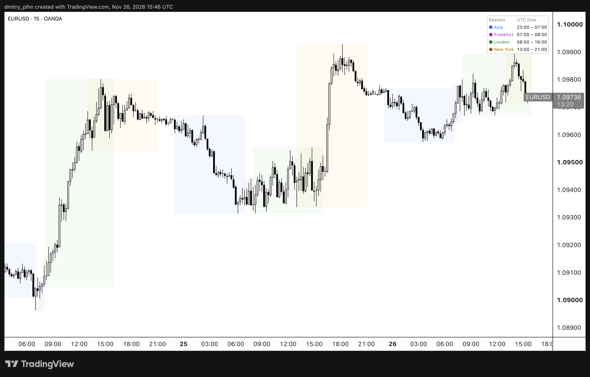
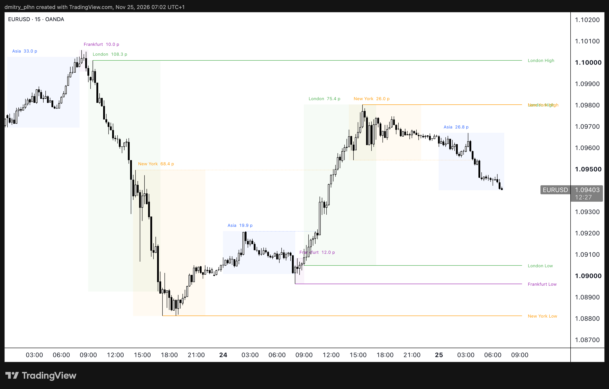
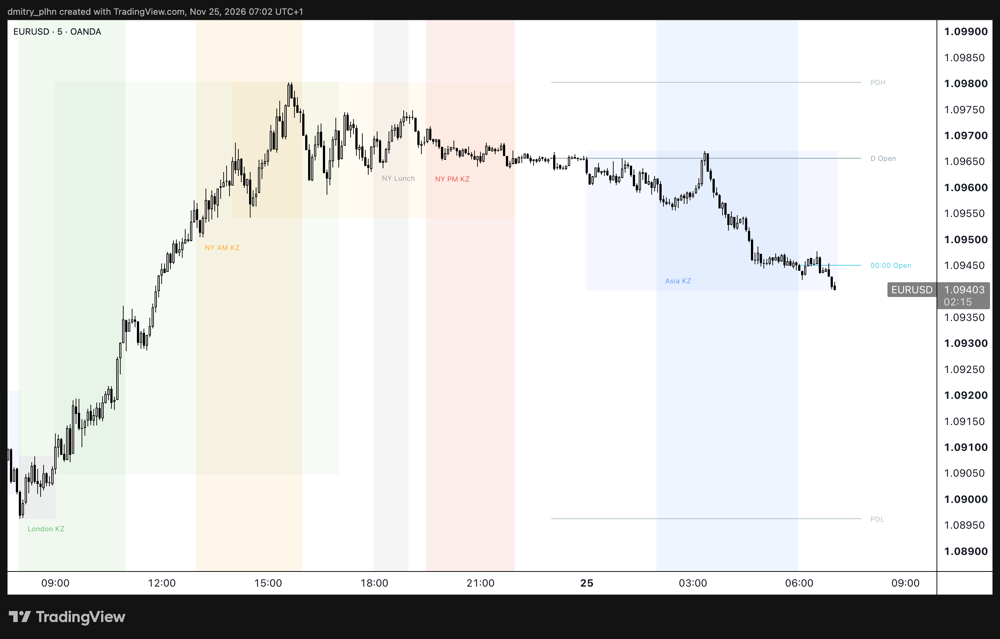
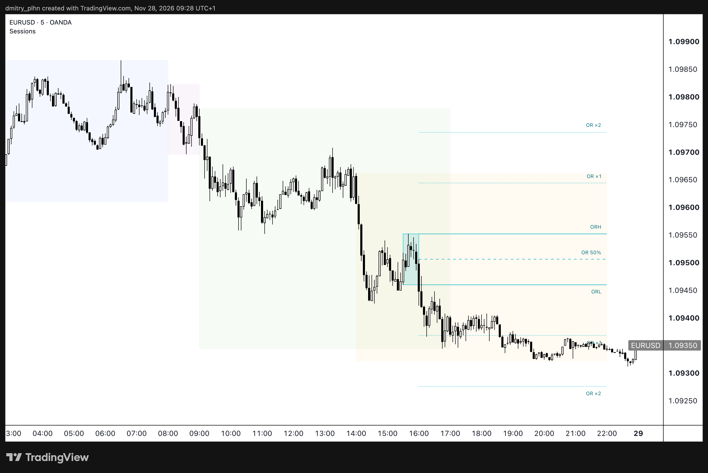
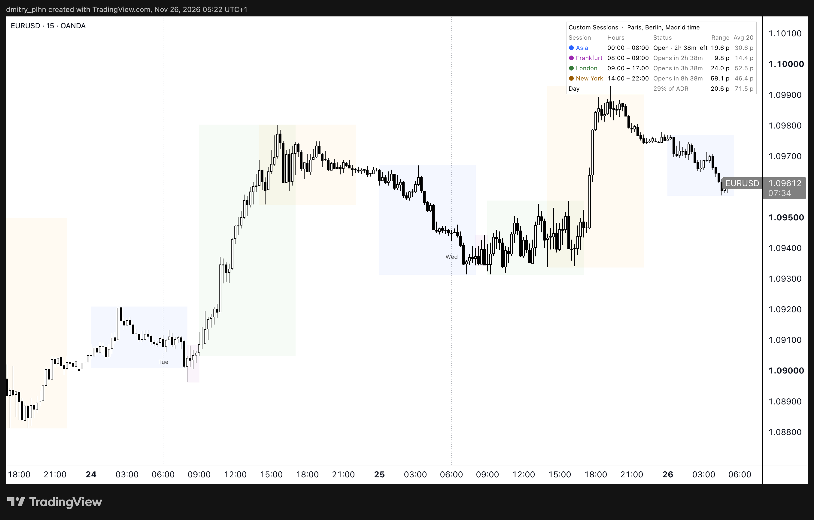

# Custom Sessions Indicator

**Sessions, killzones, liquidity levels, opening prices, opening range and a dashboard — one TradingView overlay, every part of it configurable.**

**English** · [Русский](README.ru.md) · [Français](README.fr.md)

[**Open on TradingView**](https://www.tradingview.com/script/ticv4Yo6-Custom-Sessions-Indicator/) · [Latest release](https://github.com/DmytroPalahin/sessions-indicator/releases/latest) · [Settings](docs/SETTINGS.md) · [FAQ](docs/FAQ.md) · [Changelog](CHANGELOG.md) · [Report a bug](https://github.com/DmytroPalahin/sessions-indicator/issues/new/choose)

Default settings on EURUSD, 15 minutes: Asia, Frankfurt, London and New York.

---

## What it is

A single Pine Script v6 indicator that maps the trading day on your chart. Out of the box it draws the Asia,
Frankfurt, London and New York sessions as soft colour boxes. Everything else is one checkbox away and off by default,
so the chart stays clean until you ask for more.

| # | Module | What you get |
| --- | -------- | -------------- |
| ① | **General** | History depth, timeframe limit, and your own timezone, so the dashboard can show every session on your clock |
| ② | **Sessions** | 5 slots: Asia, Frankfurt, London, New York and one spare, each in the local time of its city. Name, hours, city and colour are yours to change |
| ③ | **Session display** | Box, background, both or hidden · label with name and range · open line · 50% midline |
| ④ | **Session high / low levels** | Highs and lows stay on the chart until price trades through them |
| ⑤ | **Killzones** | 5 more slots with their own look, preset to the usual Asia / London / New York windows |
| ⑥ | **Previous day / week / month** | PDH/PDL, PWH/PWL, PMH/PML |
| ⑦ | **Opening prices** | Day, week, month, midnight and one custom time of day |
| ⑧ | **Opening range** | Range box, extended lines, midline, projections and breakout markers |
| ⑨ | **Time tools** | Day separators and weekday labels |
| ⑩ | **Dashboard** | Which session is open, its hours on your own clock, time left or time to open, current range against its average, day range against ADR |
| ⑪ | **Style** | Text size, line style and width, label options, a filter for distant levels |

## Screenshots

Every picture below is the same indicator with a few checkboxes switched on. The captions name them.

<table>
<tr>
<td width="50%" valign="top">

<b>Labels and session levels</b> 
③ <i>Label</i> = <code>Name + range</code> · ④ <i>Extend session high / low until broken</i>
</td>
<td width="50%" valign="top">

<b>Killzones, previous day and opening prices</b> 
⑤ <i>Show killzones</i> · ⑥ <i>Previous day high / low</i> · ⑦ <i>Day open</i>, <i>Midnight open</i>
</td>
</tr>
<tr>
<td width="50%" valign="top">

<b>Opening range</b> 
⑧ <i>Show opening range</i>, <i>Projection 2 ×</i> = <code>2</code>
</td>
<td width="50%" valign="top">

<b>Dashboard and time tools</b> 
⑩ <i>Show dashboard</i> · ⑨ <i>Day separators</i>, <i>Weekday labels</i>
</td>
</tr>
</table>

EURUSD on 15 and 5 minutes, light chart theme. Click a picture to open it in full size.

## Quick start

**From TradingView.** Open the [publication on TradingView](https://www.tradingview.com/script/ticv4Yo6-Custom-Sessions-Indicator/) and press **Use on chart**. The
publication is a protected script: it works like any indicator, and its code is the file in this repository.

**From the source.**

1. Open [src/custom_sessions_indicator.pine](src/custom_sessions_indicator.pine) and copy the whole file.
2. On TradingView open any chart, then the **Pine Editor**.
3. Replace the editor content with the copied code and press **Add to chart**.
4. Open the indicator **Settings** to switch modules on. Labels with the session name and range are in
   *③ Session display → Label*.

The indicator needs an intraday chart for sessions (60 minutes or lower by default).

## Default sessions

Every session is written in the local time of its own city and follows that city's daylight saving time. The chart
draws it on your clock, so there is nothing to convert.

| Slot | Name | Hours | City | On |
| ------ | ------ | ------- | ------ | ---- |
| 1 | Asia | 08:00 – 16:00 | Tokyo | yes |
| 2 | Frankfurt | 08:00 – 09:00 | Frankfurt | yes |
| 3 | London | 08:00 – 16:00 | London | yes |
| 4 | New York | 08:00 – 16:00 | New York | yes |
| 5 | Sydney | 08:00 – 16:00 | Sydney | no |

Asia, London, New York and Sydney are the 08:00 – 16:00 working day of their city.
Frankfurt is the hour before London opens. Asia is blue, Frankfurt purple, London green and New York orange, drawn
as soft boxes without a border. *③ Session display → Style → Background* shades the whole height of the chart
instead of the range.

Killzone presets: Asia 20:00 – 00:00, London 02:00 – 05:00, NY AM 07:00 – 10:00, NY Lunch 12:00 – 13:00,
NY PM 13:30 – 16:00, in New York time — the *Clock* of that group. These are conventions, not rules: every window
is editable.

TradingView does not tell an indicator which timezone your chart shows. Pick it once in *① General → My timezone*
and the dashboard lists every session on your own clock; a row with the city `My time` takes its hours as you see
them on your chart.

## Documentation

| Document | Read it when you want to |
| ---------- | -------------------------- |
| [docs/SETTINGS.md](docs/SETTINGS.md) | know what every input does and what its default is |
| [docs/FAQ.md](docs/FAQ.md) | fix "nothing is drawn" or "sessions are an hour off" |
| [docs/ARCHITECTURE.md](docs/ARCHITECTURE.md) | understand or change the code |
| [docs/TESTING.md](docs/TESTING.md) | test a change before sending it |
| [docs/PUBLISHING.md](docs/PUBLISHING.md) | publish a release on TradingView |
| [CHANGELOG.md](CHANGELOG.md) | see what changed between versions |
| [SUPPORT.md](SUPPORT.md) | ask a question or report a problem |

## How it behaves

- **No repainting from the future.** Previous day / week / month values are read with a one-bar offset, so a
  historical bar shows exactly what was known when it closed.
- **Session levels break on a trade-through.** A high is broken by a higher high, a low by a lower low.
- **Opening range breakouts need a close.** The marker appears when a bar closes outside the range.
- **Live levels cannot disappear.** TradingView keeps only the newest 500 lines, labels and boxes. Current levels are
  redrawn on the last bar, so the limit only ever removes old history.

## Limitations

These come from how Pine Script and TradingView work. They are listed so that nothing surprises you.

- Sessions, killzones and the opening range are intraday tools. They hide above the timeframe set in *① General*.
- Levels far from price squeeze the candles, because TradingView fits every level of an indicator into the price
  scale. *⑪ Style → Hide levels farther than* removes them; so does *Scale price chart only* in the price-scale menu.
- The dashboard clock follows the schedule, not the exchange calendar: it does not know about weekends and holidays.
  Like every script, it refreshes when the chart receives a tick.
- Session averages are computed from the bars loaded on the chart.
- A custom opening price needs a bar that opens at that time (or within one bar after it).

## Project status

Version 4.0.0 is the current release and the version published on TradingView. It compiles and runs with no errors
and no warnings, and it has been run on forex, crypto, futures and stock charts from 30 seconds to daily. The
verification log in [docs/TESTING.md](docs/TESTING.md) lists what has been checked and what is still open.

## Roadmap

- Standard-deviation projections of a chosen session range
- Session volume profile
- Statistics: how often one session breaks the range of another
- One label for levels that share a price, instead of two labels printed over each other
- When the level list is full, drop broken levels before live ones
- Session VWAP, re-anchored at each session, day, week or month — built and run on live charts, kept on the
  `feature/vwap` branch until a later release
- Alerts for session starts, broken levels and opening range breakouts — built and tried on a live chart, kept on
  the `feature/alerts` branch until a later release

Have an idea? [Open a feature request](https://github.com/DmytroPalahin/sessions-indicator/issues/new/choose).

## Links

| | |
| --- | --- |
| Indicator on TradingView | [Custom Sessions Indicator](https://www.tradingview.com/script/ticv4Yo6-Custom-Sessions-Indicator/) |
| Author on TradingView | [dmitry_plhn](https://www.tradingview.com/u/dmitry_plhn/) |
| Source code | [src/custom_sessions_indicator.pine](src/custom_sessions_indicator.pine) |
| Latest release | [DmytroPalahin/sessions-indicator/releases/latest](https://github.com/DmytroPalahin/sessions-indicator/releases/latest) |
| All releases | [Releases](https://github.com/DmytroPalahin/sessions-indicator/releases) · [Changelog](CHANGELOG.md) |
| Bugs and ideas | [Issues](https://github.com/DmytroPalahin/sessions-indicator/issues) |
| Security reports | [SECURITY.md](SECURITY.md) |

## Contributing and support

Bug reports, ideas and pull requests are welcome. Start with [CONTRIBUTING.md](CONTRIBUTING.md).
For help see [SUPPORT.md](SUPPORT.md). Please follow the [Code of Conduct](CODE_OF_CONDUCT.md).

## License

[Mozilla Public License 2.0](LICENSE). You may use, modify and share the script; changes to its files stay open
under the same license.

## Disclaimer

This indicator is a charting tool. It is not financial advice and it does not predict the market. Trading involves
risk; you are responsible for your own decisions.
