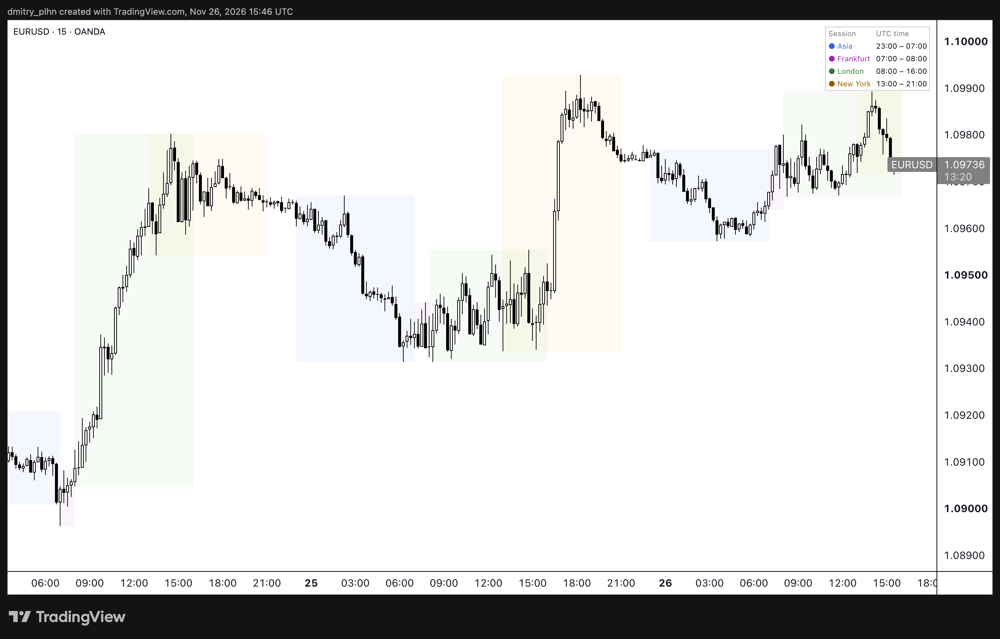
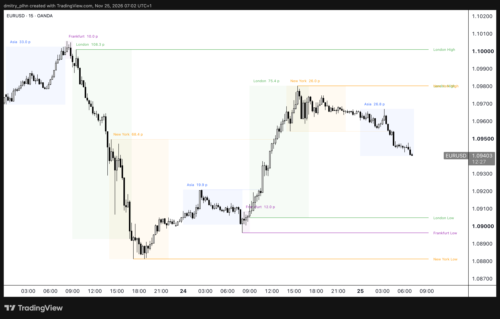
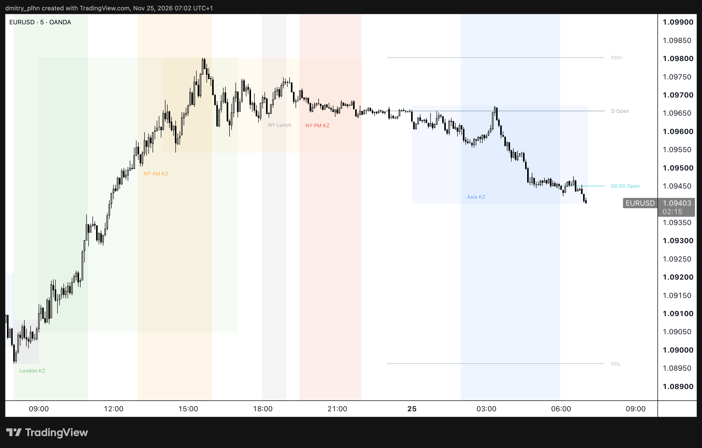
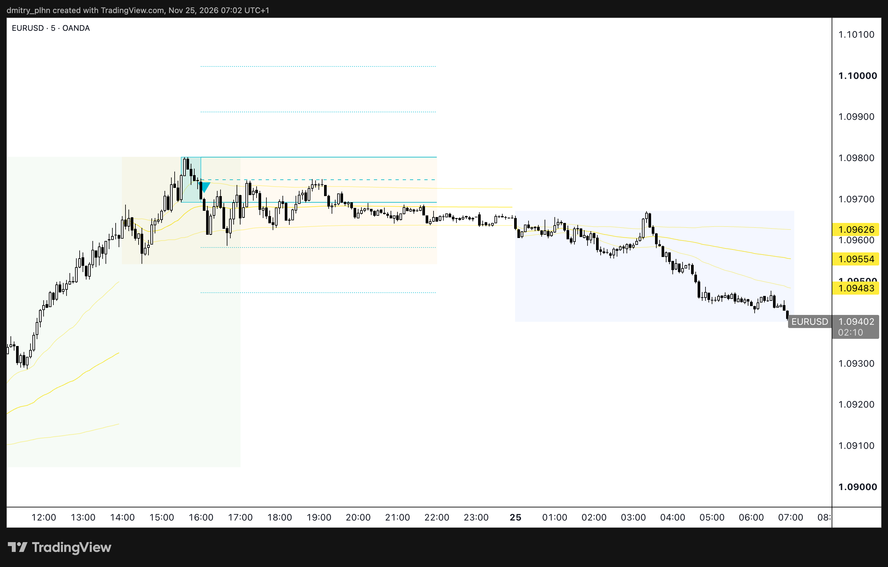
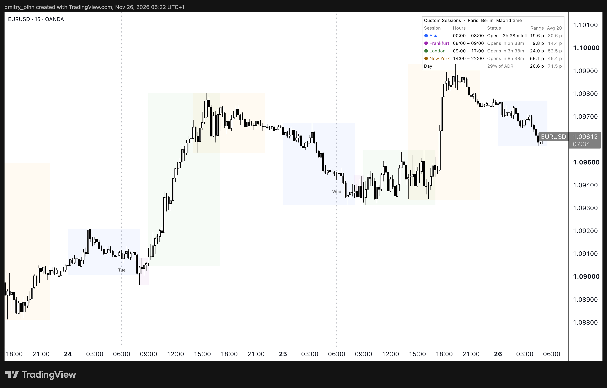

# Custom Sessions Indicator

**Сессии, killzones, уровни ликвидности, цены открытия, opening range, сессионный VWAP и дашборд — один индикатор для TradingView, в котором настраивается всё.**

[English](README.md) · **Русский**

[**Открыть на TradingView**](https://www.tradingview.com/script/ticv4Yo6-Custom-Sessions-Indicator/) · [Последний релиз](https://github.com/DmytroPalahin/sessions-indicator/releases/latest) · [Настройки](docs/SETTINGS.md) · [FAQ](docs/FAQ.md) · [История изменений](CHANGELOG.md) · [Сообщить об ошибке](https://github.com/DmytroPalahin/sessions-indicator/issues/new/choose)

Настройки по умолчанию на EURUSD, 15 минут: Asia, Frankfurt, London и New York.

---

## Что это

Один индикатор на Pine Script v6, который размечает торговый день на графике. Сразу после установки он рисует сессии
Asia, Frankfurt, London и New York мягкими цветными боксами. Всё остальное включается одной галочкой и по умолчанию
выключено, поэтому график остаётся чистым, пока вы сами не попросите больше.

| № | Модуль | Что даёт |
|---|--------|----------|
| ① | **General** | Один часовой пояс на весь индикатор (с учётом летнего времени), глубина истории, лимит таймфрейма |
| ② | **Sessions** | 5 слотов: Asia, Frankfurt, London, New York и один запасной. Название, время и цвет меняются |
| ③ | **Session display** | Бокс, фон, оба варианта или скрыто · подпись с названием и диапазоном · линия открытия · середина 50% |
| ④ | **Session high / low levels** | High и low сессии остаются на графике, пока цена их не пробьёт |
| ⑤ | **Killzones** | Ещё 5 слотов со своим оформлением, с привычными окнами Asia / London / New York |
| ⑥ | **Previous day / week / month** | PDH/PDL, PWH/PWL, PMH/PML |
| ⑦ | **Opening prices** | Открытие дня, недели, месяца, полуночи и одного своего времени |
| ⑧ | **Opening range** | Бокс диапазона, продлённые линии, середина, проекции и метки пробоя |
| ⑨ | **Session VWAP** | Пересчёт с начала каждой сессии, дня, недели или месяца, с полосами по желанию |
| ⑩ | **Time tools** | Разделители дней и подписи дней недели |
| ⑪ | **Dashboard** | Какая сессия открыта, сколько до конца или до открытия, диапазон против среднего, день против ADR |
| ⑫ | **Style** | Размер текста, стиль и толщина линий, подписи уровней, фильтр далёких уровней |

## Скриншоты

На каждой картинке тот же индикатор, в котором включено несколько галочек. В подписях указано, какие именно.

<table>
<tr>
<td width="50%" valign="top">

<b>Подписи и уровни сессий</b> 
③ <i>Label</i> = <code>Name + range</code> · ④ <i>Extend session high / low until broken</i>
</td>
<td width="50%" valign="top">

<b>Killzones, прошлый день и цены открытия</b> 
⑤ <i>Show killzones</i> · ⑥ <i>Previous day high / low</i> · ⑦ <i>Day open</i>, <i>Midnight open</i>
</td>
</tr>
<tr>
<td width="50%" valign="top">

<b>Opening range и сессионный VWAP</b> 
⑧ <i>Show opening range</i>, <i>Projection 2 ×</i> = <code>2</code> · ⑨ <i>Show VWAP</i>, <i>Bands ×</i> = <code>1</code>
</td>
<td width="50%" valign="top">

<b>Дашборд и инструменты времени</b> 
⑪ <i>Show dashboard</i> · ⑩ <i>Day separators</i>, <i>Weekday labels</i>
</td>
</tr>
</table>

EURUSD на 15 и 5 минутах, светлая тема графика. Нажмите на картинку, чтобы открыть её в полном размере.

## Быстрый старт

**Из TradingView.** Откройте [публикацию на TradingView](https://www.tradingview.com/script/ticv4Yo6-Custom-Sessions-Indicator/) и нажмите **Use on chart**. Публикация
сделана с закрытым кодом (protected): она работает как обычный индикатор, а её код — это файл из этого репозитория.

**Из исходника.**

1. Откройте [src/custom_sessions_indicator.pine](src/custom_sessions_indicator.pine) и скопируйте файл целиком.
2. В TradingView откройте любой график, затем **Pine Editor**.
3. Замените содержимое редактора скопированным кодом и нажмите **Add to chart**.
4. Откройте **Settings** индикатора и включите нужные модули. Подписи с названием и диапазоном сессии включаются в
   *③ Session display → Label*.

Для сессий нужен внутридневной график (по умолчанию 60 минут и ниже).

## Сессии по умолчанию

Всё время записано в поясе из *① General*, по умолчанию это `America/New_York`. Эта настройка говорит, как читать
числа ниже; это не ваш часовой пояс, и график продолжает показывать ваши часы.

| Слот | Название | Окно | Включён |
|------|----------|------|---------|
| 1 | Asia | 18:00 – 02:00 | да |
| 2 | Frankfurt | 02:00 – 03:00 | да |
| 3 | London | 03:00 – 11:00 | да |
| 4 | New York | 08:00 – 16:00 | да |
| 5 | Sydney | 16:00 – 00:00 | нет |

Asia, London, New York и Sydney — это рабочий день своего города с 08:00 до 16:00, записанный по нью-йоркскому
времени. Frankfurt — час перед открытием Лондона. Asia синяя, Frankfurt фиолетовая, London зелёная, New York
оранжевая; боксы мягкие, без рамки.

Killzones по умолчанию: Asia 20:00 – 00:00, London 02:00 – 05:00, NY AM 07:00 – 10:00, NY Lunch 12:00 – 13:00,
NY PM 13:30 – 16:00. Это общепринятые значения, а не правило: любое окно можно изменить.

## Документация

Подробная документация написана на английском.

| Документ | Зачем читать |
|----------|--------------|
| [docs/SETTINGS.md](docs/SETTINGS.md) | что делает каждая настройка и какое у неё значение по умолчанию |
| [docs/FAQ.md](docs/FAQ.md) | что делать, если ничего не рисуется или сессии сдвинуты на час |
| [docs/ARCHITECTURE.md](docs/ARCHITECTURE.md) | как устроен код |
| [docs/TESTING.md](docs/TESTING.md) | как проверить изменение |
| [docs/PUBLISHING.md](docs/PUBLISHING.md) | как опубликовать релиз на TradingView |
| [CHANGELOG.md](CHANGELOG.md) | что менялось между версиями |
| [SUPPORT.md](SUPPORT.md) | где задать вопрос или сообщить о проблеме |

## Как он себя ведёт

- **Не заглядывает в будущее.** Значения прошлого дня, недели и месяца берутся со сдвигом на один бар, поэтому
  исторический бар показывает ровно то, что было известно на момент его закрытия.
- **Уровень сессии пробивается проторговкой.** High пробит более высоким high, low — более низким low.
- **Пробой opening range требует закрытия.** Метка появляется, когда бар закрылся за пределами диапазона.
- **Актуальные уровни не пропадают.** TradingView хранит только 500 самых новых линий, меток и боксов. Текущие уровни
  перерисовываются на последнем баре, поэтому лимит убирает только старую историю.

## Ограничения

Они следуют из того, как работают Pine Script и TradingView.

- Сессии, killzones и opening range — внутридневные инструменты. Выше таймфрейма из *① General* они скрываются.
- Уровни далеко от цены сжимают свечи, потому что TradingView вписывает в шкалу цены все уровни индикатора.
  Их убирает настройка *⑫ Style → Hide levels farther than* или пункт *Scale price chart only* в меню шкалы цены.
- Сессионному VWAP нужен объём. На инструментах без объёма он не рисуется.
- Часы дашборда идут по расписанию, а не по календарю биржи: о выходных и праздниках они не знают. Как любой скрипт,
  дашборд обновляется, когда на график приходит тик.
- Средние значения сессий считаются по барам, загруженным на график.
- Цене открытия в своё время нужен бар, который открывается в это время (или в пределах одного бара после него).

## Статус проекта

Версия 1.3.0 — текущий релиз, и именно она опубликована на TradingView. Она компилируется и работает без ошибок и
предупреждений и запускалась на графиках форекса, крипты, фьючерсов и акций на таймфреймах от 30 секунд до дня. Что
проверено и что ещё осталось, записано в журнале проверок в [docs/TESTING.md](docs/TESTING.md).

## Планы

- Свой часовой пояс у каждой сессии: Asia по токийскому времени, New York по нью-йоркскому
- Проекции стандартных отклонений от диапазона выбранной сессии
- Профиль объёма сессии
- Статистика: как часто одна сессия пробивает диапазон другой
- Одна подпись для уровней с одинаковой ценой вместо двух подписей друг на друге
- Когда список уровней заполнен, сначала убирать пробитые уровни, а не действующие
- Текст подписей, который остаётся контрастным на светлом графике
- Алерты на начало сессии, пробой уровня и пробой opening range — модуль написан и проверен на живом графике, он
  лежит в ветке `feature/alerts` до одного из следующих релизов

Есть идея? [Откройте запрос на новую функцию](https://github.com/DmytroPalahin/sessions-indicator/issues/new/choose).

## Ссылки

| | |
|---|---|
| Индикатор на TradingView | [Custom Sessions Indicator](https://www.tradingview.com/script/ticv4Yo6-Custom-Sessions-Indicator/) |
| Автор на TradingView | [dmitry_plhn](https://www.tradingview.com/u/dmitry_plhn/) |
| Исходный код | [src/custom_sessions_indicator.pine](src/custom_sessions_indicator.pine) |
| Последний релиз | [DmytroPalahin/sessions-indicator/releases/latest](https://github.com/DmytroPalahin/sessions-indicator/releases/latest) |
| Все релизы | [Releases](https://github.com/DmytroPalahin/sessions-indicator/releases) · [История изменений](CHANGELOG.md) |
| Ошибки и идеи | [Issues](https://github.com/DmytroPalahin/sessions-indicator/issues) |
| Сообщения о безопасности | [SECURITY.md](SECURITY.md) |

## Участие и поддержка

Сообщения об ошибках, идеи и pull request приветствуются. Начните с [CONTRIBUTING.md](CONTRIBUTING.md).
Где получить помощь, написано в [SUPPORT.md](SUPPORT.md). Пожалуйста, соблюдайте
[Code of Conduct](CODE_OF_CONDUCT.md).

## Лицензия

[Mozilla Public License 2.0](LICENSE). Скрипт можно использовать, менять и распространять; изменения его файлов
остаются открытыми под той же лицензией.

## Отказ от ответственности

Индикатор — это инструмент разметки графика. Он не является финансовой рекомендацией и не предсказывает рынок.
Торговля связана с риском, и решения вы принимаете сами.
