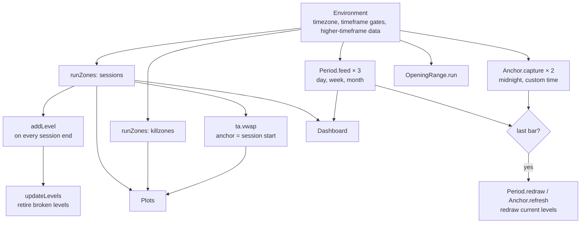

# Architecture

This document explains how the indicator is built and why. Read it before changing the code.

## The constraints we design around

Pine Script is not a general-purpose language, and four of its rules shape everything here.

1. **The script runs once per bar, left to right.** There is no main loop of our own. State that must survive from one
   bar to the next lives in `var` variables.
2. **An indicator is one file.** Pine has no local imports; only libraries published on TradingView can be imported.
   Structure therefore comes from regions, types and naming, not from folders.
3. **Drawings are limited.** A script keeps at most 500 lines, 500 labels and 500 boxes. When the limit is reached
   TradingView silently deletes the oldest ones.
4. **`plot` and `bgcolor` must be called in the global scope.** They cannot sit in a loop or a
   function, so the code that feeds them is written out once per slot.

## File layout

[src/custom_sessions_indicator.pine](../src/custom_sessions_indicator.pine) is divided into eleven regions. A region
only uses what the regions above it define.

| # | Region | Contains | Rule |
|---|--------|----------|------|
| 1 | Constants | compile-time values, group names, tooltips | no logic |
| 2 | Enums | every dropdown of the settings panel | one enum per dropdown |
| 3 | Inputs | the settings panel | one block per module, prefixed `i_` |
| 4 | Environment | values derived once per bar from the chart and the inputs | read-only for everything below |
| 5 | Types | state containers | fields only |
| 6 | Helpers | conversion and formatting | pure functions, no drawing, no state |
| 7 | Engine | methods that advance state and draw | the only place that creates drawings |
| 8 | State | the long-lived objects | created once, with `var` |
| 9 | Pipeline | the per-bar orchestration | reads top to bottom, no logic of its own |
| 10 | Plots | `bgcolor` and `plot` calls | global scope |
| 11 | Dashboard | the table | runs on the last bar only |

## The per-bar pipeline

## Types

| Type | Role | Draws? |
|------|------|--------|
| `Tracker` | State machine of one recurring time window: active / started / ended, open, high, low, the times of the extremes, the last completed window and a buffer of past ranges. | never |
| `ZoneView` | How a family of zones looks: style, transparencies, border, caption. One instance for sessions, one for killzones. | — |
| `Zone` | One slot of the settings panel: its configuration, its `Tracker` and the drawings of the running window. | yes |
| `Level` | A session high or low waiting to be broken. | yes |
| `Marker` | A horizontal segment with a tag at its right end. | yes |
| `Period` | Day, week or month: previous high and low, open, running range, break flags, three `Marker`s. | through `Marker` |
| `Anchor` | An opening price taken at a fixed time of day, with one `Marker`. | through `Marker` |
| `OpeningRange` | A `Tracker`, the lines extended from it and the breakout state. | yes |

## Design decisions

### 1. State and drawing are separate

`Tracker` knows what a window is doing and never touches the chart. `Zone.draw`, `OpeningRange.run` and the others
read a tracker and draw. Sessions, killzones and the opening range therefore share one implementation of "what is a
time window", and a display bug cannot corrupt statistics.

### 1a. A window run has an identity

A tracker cannot rely on seeing a bar *outside* the window between two runs. On a regular-hours chart the 16:00 bar
is followed directly by the next day's 09:30 bar, and both are inside a 08:00–17:00 session. `windowKey` gives every
bar the calendar date on which its run started; when the key changes while the window is active, the tracker ends the
old run and starts the new one on the same bar. This also makes 24-hour windows work.

### 2. One engine for sessions and killzones

A killzone is a session with a different look. Both are `Zone` objects in an array; the only difference is the
`ZoneView` passed to `runZones`. Adding a slot is one input row and one `push`.

### 3. Live levels are redrawn, history is frozen

Lines that must be visible *now* — previous highs and lows, opening prices — are deleted and recreated on the last bar
(`Marker.place`). A freshly created object is always the newest, so the 500-object garbage collector can never remove it.
Everything historical is created once and left alone.

### 4. Higher-timeframe data without look-ahead

Previous day, week and month values come from `request.security` with `lookahead_on` and a one-bar offset
(`high[1]`, `low[1]`). This is the documented non-repainting pattern: a historical bar receives the value that was
already final when the bar opened. The open and the start time of the current period are known from its first bar, so
reading them is not a look-ahead either.

Tracking these values by hand was rejected: a 1-minute chart loads only a few weeks, so the previous month would be
wrong or missing.

### 5. Time is read in one place

Every time comparison goes through `TZ`, a named IANA zone by default. Named zones carry their own daylight saving
rules, so the weeks in which New York and London are out of step are handled without any date arithmetic in the script.

### 6. Timeframe gates instead of wrong drawings

A session on a daily chart is meaningless, and a previous-week level on a weekly chart is the bar itself. Each module
checks the chart timeframe and stays silent when it cannot be right (`intradayOk`, `Period.visible`).

### 7. Breaks and breakouts are defined once

- A **session level** or a **previous high / low** is broken by a trade-through: `high > level` or `low < level`.
- An **opening range breakout** is a close outside the range on a confirmed bar, once per side.

Markers and line styles read the same flags, and so will alerts when they return.

### 8. Enums for every dropdown

Dropdowns are `enum` inputs, not strings. A typo in a comparison is a compile error instead of a silent bug.

### 9. Every function has its own name

Pine does not let an overloaded function read global variables (compile error `CE10182`), and a user method that
shares its name with a built-in method counts as an overload. Methods here read inputs and environment values
directly, so each one has a unique name: `Tracker.advance`, `Period.feed`, `Anchor.capture`, `OpeningRange.run`,
`Marker.place`. `tools/check.py` enforces this.

### 10. No wrapped lines

Pine reserves multiples of four spaces for blocks and requires other indentations for wrapped lines. To keep that rule
out of everyone's way the source does not wrap lines at all; long calls stay on one line.

## Object budget

| Drawing | Per day, defaults | Per day, everything on |
|---------|-------------------|------------------------|
| Boxes | 3 | 9 |
| Labels | 3 | about 22 |
| Lines | 0 | about 30 |

With everything enabled the 500-line limit covers roughly two weeks of history, which is why *History* defaults to
20 days and why live levels are redrawn.

## Realtime behaviour

On the realtime bar Pine re-runs the script on every tick and rolls `var` state back to the last confirmed bar first.
The design relies on that: a level broken intrabar is "re-broken" on each tick and stays broken at the close, because
a bar's high and low only ever widen.

## Parked: alerts

The engine reports events on every bar: zones that started or ended, session levels that broke, previous highs and
lows that broke, opening range breakouts. An alerts module that turned them into `alertcondition()` entries and
`alert()` messages was built and tried on a live chart, then left out of the first release to keep it focused. It
lives on the `feature/alerts` branch. The event outputs stay in the engine, so bringing alerts back means adding one
region and one group of inputs, not touching the engine.

## Scale and distant levels

TradingView includes script drawings in the automatic price scale. A level far from price would squeeze the candles,
so `tooFar` lets the user cap the distance (in average daily ranges): markers beyond it are not drawn and session
levels fold back to their first bar.

## Known limits

- Session averages and the running day range depend on the bars loaded on the chart.
- The dashboard status uses the wall clock; it does not know the exchange calendar.
