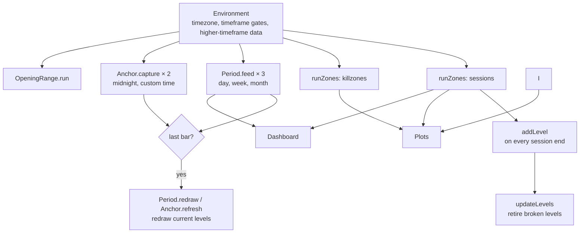

# Architecture

This document explains how the indicator is built and why. Read it before changing the code.

## The constraints we design around

Pine Script is not a general-purpose language, and four of its rules shape everything here.

1. **The script runs once per bar, left to right.** There is no main loop of our own. State that must survive from one
   bar to the next lives in `var` variables.
2. **An indicator is one file.** Pine has no local imports; only libraries published on TradingView can be imported.
   Structure therefore comes from regions, types and naming, not from folders.
3. **Drawings are limited.** A script keeps at most 500 lines, 500 labels and 500 boxes. When the limit is reached
   TradingView silently deletes the oldest ones.
4. **`plot` and `bgcolor` must be called in the global scope.** They cannot sit in a loop or a
   function, so the code that feeds them is written out once per slot.

## File layout

[src/custom_sessions_indicator.pine](../src/custom_sessions_indicator.pine) is divided into eleven regions. A region
only uses what the regions above it define.

| # | Region | Contains | Rule |
| --- | -------- | ---------- | ------ |
| 1 | Constants | compile-time values, group names, tooltips | no logic |
| 2 | Enums | every dropdown of the settings panel | one enum per dropdown |
| 3 | Inputs | the settings panel | one block per module, prefixed `i_` |
| 4 | Environment | values derived once per bar from the chart and the inputs | read-only for everything below |
| 5 | Types | state containers | fields only |
| 6 | Helpers | conversion and formatting | pure functions, no drawing, no state |
| 7 | Engine | methods that advance state and draw | the only place that creates drawings |
| 8 | State | the long-lived objects | created once, with `var` |
| 9 | Pipeline | the per-bar orchestration | reads top to bottom, no logic of its own |
| 10 | Plots | `bgcolor` and `plot` calls | global scope |
| 11 | Dashboard | the table | runs on the last bar only |

## The per-bar pipeline

## Types

| Type | Role | Draws? |
| ------ | ------ | -------- |
| `Tracker` | State machine of one recurring time window: active / started / ended, open, high, low, the times of the extremes, the last completed window and a buffer of past ranges. | never |
| `ZoneView` | How a family of zones looks: style, transparencies, border, caption. One instance for sessions, one for killzones. | — |
| `Zone` | One slot of the settings panel: its configuration, the timezone its hours are written in, its `Tracker` and the drawings of the running window. | yes |
| `Level` | A session high or low waiting to be broken. | yes |
| `Marker` | A horizontal segment with a tag at its right end. | yes |
| `Period` | Day, week or month: previous high and low, open, running range, break flags, three `Marker`s. | through `Marker` |
| `Anchor` | An opening price taken at a fixed time of day, with one `Marker`. | through `Marker` |
| `OpeningRange` | A `Tracker`, the lines extended from it and the breakout state. | yes |

## Design decisions

### 1. State and drawing are separate

`Tracker` knows what a window is doing and never touches the chart. `Zone.draw`, `OpeningRange.run` and the others
read a tracker and draw. Sessions, killzones and the opening range therefore share one implementation of "what is a
time window", and a display bug cannot corrupt statistics.

### 1a. A window run has an identity

A tracker cannot rely on seeing a bar *outside* the window between two runs. On a regular-hours chart the 16:00 bar
is followed directly by the next day's 09:30 bar, and both are inside a 08:00–17:00 session. `windowKey` gives every
bar the calendar date on which its run started; when the key changes while the window is active, the tracker ends the
old run and starts the new one on the same bar. This also makes 24-hour windows work.

### 2. One engine for sessions and killzones

A killzone is a session with a different look. Both are `Zone` objects in an array; the only difference is the
`ZoneView` passed to `runZones`. Adding a slot is one input row and one `push`.

### 3. Live levels are redrawn, history is frozen

Lines that must be visible *now* — previous highs and lows, opening prices — are deleted and recreated on the last bar
(`Marker.place`). A freshly created object is always the newest, so the 500-object garbage collector can never remove it.
Everything historical is created once and left alone.

### 4. Higher-timeframe data without look-ahead

Previous day, week and month values come from `request.security` with `lookahead_on` and a one-bar offset
(`high[1]`, `low[1]`). This is the documented non-repainting pattern: a historical bar receives the value that was
already final when the bar opened. The open and the start time of the current period are known from its first bar, so
reading them is not a look-ahead either.

Tracking these values by hand was rejected: a 1-minute chart loads only a few weeks, so the previous month would be
wrong or missing.

### 5. Every time names its clock

A session row carries the city whose local time its hours are written in; the killzones, the opening range, the
midnight and custom opens and the day separators each have a *Clock* in their own group, New York by default. A
`Zone` stores its timezone, and everything that asks "is this bar inside?" goes through it: `time()`, the
identity of a run and the dashboard countdown. Named IANA zones carry their own daylight saving rules, so the
weeks in which New York, London and Sydney are out of step need no date arithmetic in the script.

There is no timezone for the whole indicator. A global field called "timezone" is read by users as "my
timezone", and it was set to the user's own city with every window moving as a result. A clock that sits next
to the hours it governs cannot be misread that way.

What users ask for is hours "as on my chart". A script cannot do that by itself: the timezone of the chart is a
display setting that Pine does not expose. Most public session indicators therefore write every window in one
timezone, UTC or New York, and leave the conversion to the user; a few give each session the timezone of its
city; one offers a "your timezone" mode for the times it prints. This script takes the second and the third:
the city per row keeps the hours true all year, and *① General → My timezone* is the one thing the user tells
the script, used for the hours table and for any clock set to `My time`.

That table is on by default. A setting that changes nothing on the screen reads as broken: with the table off,
picking a timezone had no visible effect. The other half of the question, "why does every row start at 08:00?",
is answered where it is asked: a checkbox under the rows whose title is the answer — *Hours are local: 08:00 is 8
o'clock in the row's city*. Its title is read by everyone who opens the dialog, which a group heading in small
capitals and a tooltip were not. Unticked, it reads every row in *My timezone*, for those who want to type the
hours as their chart shows them. It is declared last and joins its group at the end, so no saved setting moved.

Up to 2.1.1 there was one timezone for all sessions, New York by default. It kept the engine one line shorter and
made the settings hard to read: "London 03:00 – 11:00" only makes sense to someone who knows that the numbers are
New York time, and no label fixed that. It also put every session defined in another city's hours an hour off
while the clock changes were out of step. "London 08:00 – 16:00, London" needs no explanation, and a script cannot
read the timezone of the chart, so the hours cannot simply be shown on the user's own clock.

### 6. Timeframe gates instead of wrong drawings

A session on a daily chart is meaningless, and a previous-week level on a weekly chart is the bar itself. Each module
checks the chart timeframe and stays silent when it cannot be right (`intradayOk`, `Period.visible`).

### 7. Breaks and breakouts are defined once

- A **session level** or a **previous high / low** is broken by a trade-through: `high > level` or `low < level`.
- An **opening range breakout** is a close outside the range on a confirmed bar, once per side.

Markers and line styles read the same flags, and so will alerts when they return.

### 8. Enums for every dropdown

Dropdowns are `enum` inputs, not strings. A typo in a comparison is a compile error instead of a silent bug.

### 9. Every function has its own name

Pine does not let an overloaded function read global variables (compile error `CE10182`), and a user method that
shares its name with a built-in method counts as an overload. Methods here read inputs and environment values
directly, so each one has a unique name: `Tracker.advance`, `Period.feed`, `Anchor.capture`, `OpeningRange.run`,
`Marker.place`. `tools/check.py` enforces this.

### 10. No wrapped lines

Pine reserves multiples of four spaces for blocks and requires other indentations for wrapped lines. To keep that rule
out of everyone's way the source does not wrap lines at all; long calls stay on one line.

### 11. Level labels grow into the chart

A script cannot read how wide the right margin of the chart is, so a label that follows its line cannot be fitted
to it: with TradingView's default margin the price scale cut `London High` after a few letters. By default the
label is therefore anchored at the end of the line and grows to the left — over the line, or under it for a low,
which is the side price is not on while the level is unbroken. `levelTagStyle` picks the label style; the old
placement stays available as `After the line`.

### 12. New inputs go last

TradingView stores the settings of an indicator by the position of each input. An input added in the middle
shifts every saved value after it into the wrong field. A new input is declared after the last one, also when
its group sits earlier in the file — `i_tagSpot` is the example. Such an input still joins the group and the
`inline` row it names, at the end of that row.

A major version is the only place where inputs are reordered. 3.0.0 did it once, to put the city next to the hours
of each session row.

### 13. Text is adjusted for contrast, lines are not

A label is printed in the colour of its line or zone, so the eye links the two. The default colours suit dark
charts; on a white background most of them fell below a contrast of 3 : 1 as text. `inkOf` therefore moves a
text colour towards black on a light chart, or towards white on a dark one, in steps of a tenth until it reaches
`INK_CONTRAST` (4.5 : 1, the WCAG mark for normal text), and returns a colour that already reads well unchanged.
Every place that prints text in a user colour calls it: zone captions, level labels and the session names of
the dashboard. Lines, boxes and backgrounds use the colour as it is, because their hue is the information.

### 14. A settings row holds four controls

The settings dialog is 550 px wide. Checkbox, name, hours and city fill a row; a fifth control wraps to a second
line and breaks the table look of the group. So the five session colours share one row under the session rows, in
the same order, and the dropdown of a row shows a city name short enough for its 96 px box — `Frankfurt` fits,
`Europe/Berlin` would be cut to `Europe…`.

## Object budget

| Drawing | Per day, defaults | Per day, everything on |
| --------- | ------------------- | ------------------------ |
| Boxes | 4 | 10 |
| Labels | 0 | about 23 |
| Lines | 0 | about 30 |

With everything enabled the 500-line limit covers roughly two weeks of history, which is why *History* defaults to
20 days and why live levels are redrawn.

## Realtime behaviour

On the realtime bar Pine re-runs the script on every tick and rolls `var` state back to the last confirmed bar first.
The design relies on that: a level broken intrabar is "re-broken" on each tick and stays broken at the close, because
a bar's high and low only ever widen.

## Parked: alerts

The engine reports events on every bar: zones that started or ended, session levels that broke, previous highs and
lows that broke, opening range breakouts. An alerts module that turned them into `alertcondition()` entries and
`alert()` messages was built and tried on a live chart, then left out of the first release to keep it focused. It
lives on the `feature/alerts` branch. The event outputs stay in the engine, so bringing alerts back means adding one
region and one group of inputs, not touching the engine.

## Parked: session VWAP

A VWAP that restarts at each session, day, week or month, with optional bands, was part of versions 1.0 to 1.4.
It is taken out for now and lives on the `feature/vwap` branch. It needs nothing from the engine but the list of
sessions that started on the bar, which `runZones` still returns, so bringing it back means one group of inputs,
one step in the pipeline and three plots.

## Scale and distant levels

TradingView includes script drawings in the automatic price scale. A level far from price would squeeze the candles,
so `tooFar` lets the user cap the distance (in average daily ranges): markers beyond it are not drawn and session
levels fold back to their first bar.

## Known limits

- Session averages and the running day range depend on the bars loaded on the chart.
- The dashboard status uses the wall clock; it does not know the exchange calendar.
- Every level has its own label. Two levels at one price therefore print two labels over each other.
- A level label ends at the end of its line, `i_offset` bars after the last bar. It is complete only when the
  right margin of the chart is at least that wide.
- Lines keep the colours of the inputs. A thin line in a pale default colour can be faint on a white chart.
- The level list is trimmed by age. With `Keep, faded` a broken level can push out an older level that is still
  live.
