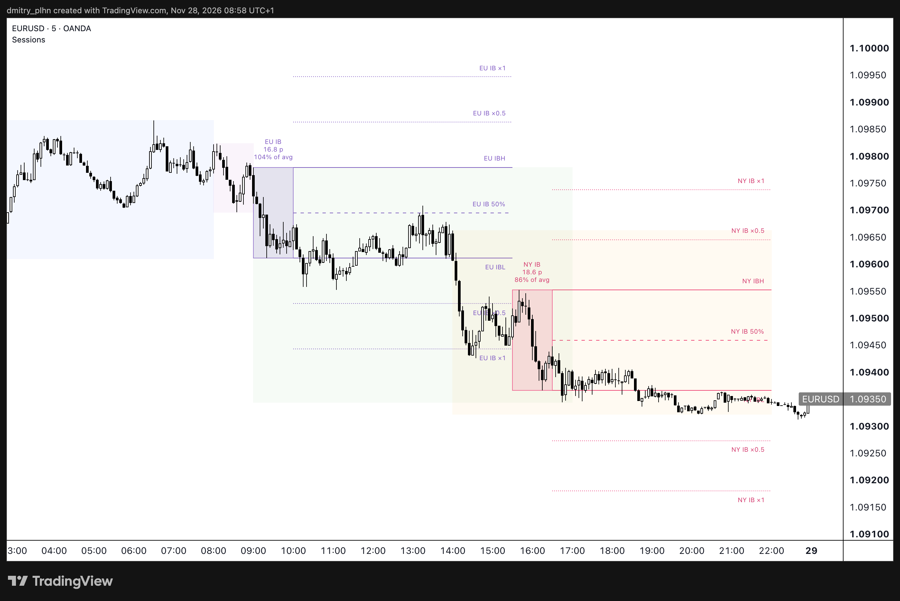
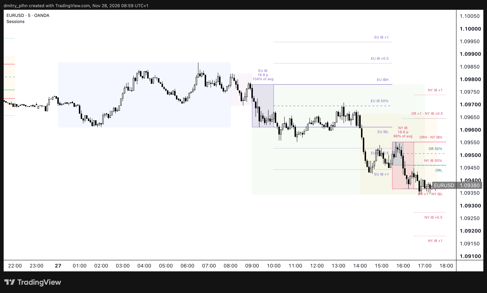

# Initial balance: examples

The initial balance, IB for short, is the range of the first hour of a session. This page shows how to set it up
for different markets and how to read what the indicator draws. Every input named here is in the group
*⑧ Opening range and initial balance* and is described in [SETTINGS.md](SETTINGS.md).

The page describes what the indicator shows. It is not trading advice.

## The two rows

*Show initial balance* switches the module on. Under it are two rows, and each row is one initial balance:

| Row | On | Name | Window | City | Lines extend for |
| ----- | ---- | ------ | -------- | ------ | ------------------ |
| 1 | yes | `EU IB` | `0900-1000` | `Frankfurt` | 5.5 hours, to 15:30 in Frankfurt |
| 2 | yes | `NY IB` | `0930-1030` | `New York` | 5.5 hours, to 16:00 in New York |

A window is written in the local time of its city, so it stays in the right place when the clocks change. The
name is free text: it starts every label of the row, on the chart and in the dashboard.

## Example 1 — both rows on a forex pair

Nothing to set: tick *Show initial balance* and leave the rest alone.

The picture is EURUSD on 5 minutes, 27 November 2026, with the chart set to Paris time. What it shows:

| What | Frankfurt, `EU IB` | New York, `NY IB` |
| ------ | -------------------- | ------------------- |
| First hour on this chart | 09:00 – 10:00 | 15:30 – 16:30 |
| High, `IBH` | 1.09779 | 1.09552 |
| Low, `IBL` | 1.09611 | 1.09366 |
| Size | 16.8 pips | 18.6 pips |
| Share of the 20-day average | 104% | 86% |
| Extension ×0.5 | 1.09863 and 1.09527 | 1.09645 and 1.09273 |
| Extension ×1 | 1.09947 and 1.09443 | 1.09738 and 1.09180 |
| Lines end at | 15:30 | 22:00 |

How to read it:

- **The box** is the first hour itself. The label over it gives the name, the size and the share of the average.
- **The solid lines** are the high and the low of that hour, the dashed line is its middle.
- **The dotted lines** are the extensions: half a range and a whole range above the high and below the low.
- **The lines of Frankfurt stop where New York begins.** With the default 5.5 hours the two sets of lines never
  overlap.
- **The whole first hour of New York is under the Frankfurt low.** `NY IBH`, 1.09552, is below `EU IBL`, 1.09611.
  Its low, 1.09366, is below the lower ×1 extension of Frankfurt, 1.09443: within that hour the price was more
  than a whole Frankfurt range under the Frankfurt low.

## Example 2 — New York only, for US index futures and stocks

The classic initial balance: 09:30 to 10:30 in New York.

| Input | Set it to |
| ------- | ----------- |
| Show initial balance | on |
| Row 1, `EU IB` | untick its checkbox |
| Row 2, `NY IB` | leave as it is: `0930-1030`, `New York` |
| IB extend, hours | leave `5.5`: the lines end at the close, 16:00 |

On a chart with regular trading hours only, such as a US stock, the first bar of the day is the first bar of the
window. On such a chart the window also fits 1-hour bars, because they open at 09:30.

## Example 3 — Frankfurt only, for the DAX and other European indices

Xetra opens at 09:00 and closes at 17:30 in Frankfurt.

| Input | Set it to |
| ------- | ----------- |
| Show initial balance | on |
| Row 1, `EU IB` | leave as it is: `0900-1000`, `Frankfurt` |
| Row 2, `NY IB` | untick its checkbox |
| IB extend, hours, first number | `7.5`, so the lines run to the Xetra close at 17:30 |

This window starts on the hour, so it is also drawn on a 1-hour chart.

## Example 4 — another first hour: London, Tokyo, crypto

A row takes any window and any city. Change the name as well, so the labels say what they are.

| Market | Name | Window | City |
| -------- | ------ | -------- | ------ |
| London, for GBP pairs and the FTSE | `LDN IB` | `0800-0900` | `London` |
| Tokyo, for JPY pairs and the Nikkei | `TYO IB` | `0900-1000` | `Tokyo` |
| A market that never closes, such as crypto | `UTC IB` | `0000-0100` | `UTC` |
| The first hour of the symbol's own exchange | `IB` | the opening hour of that exchange | `Exchange` |

There are two rows. For a third market, reuse the row you need least.

## Example 5 — the opening range inside the initial balance

A 30-minute opening range and the first-hour initial balance of New York start at the same moment, so they are
often watched together. Tick *Show opening range* and *Show initial balance*.

The picture is the same day at 11:35 in New York. The opening range is cyan, `NY IB` is pink.

- **Shared labels.** The high of the first half hour, 1.09552, was also the high of the first hour, so one label
  names both: `ORH · NY IBH`. Lines that are close but not equal share a label too: `OR ×1 · NY IBL` and
  `OR ×1 · NY IB ×0.5`.
- **Own labels.** `ORL`, `OR 50%` and `NY IB 50%` have no neighbour and keep their own.
- **While the session runs** the lines end a few bars to the right of the last bar, and the labels sit there, in
  the free space.

With *⑪ Style → Price in level labels* on, a shared label carries one price when the two lines are at one price,
and both prices when they are only close: `ORH · NY IBH  1.09552` here, and
`ORL  7225.50 · NY IBL  7222.75` on the S&P 500 future of the same day.

## Example 6 — the size of the first hour against its average

The third line of the size label compares the first hour with the average of the last days. *⑩ Dashboard →
Average length* sets how many days, 20 by default.

| Day, EURUSD on 15 minutes | `NY IB` size | Share of the average | What followed |
| --------------------------- | -------------- | ---------------------- | --------------- |
| 25 November 2026 | 21.4 pips | 91% | a bar closed above the high soon after the hour ended |
| 26 November 2026 | 13.6 pips | 61% | the bar of 11:30 in New York closed below the low |
| 27 November 2026 | 18.6 pips | 86% | the bar of 12:30 in New York closed below the low |

The first hour of 26 November was the narrow one of the three: three fifths of a usual first hour. The Frankfurt
hour of 27 November, at 104%, was an ordinary one.

Many traders expect price to leave a narrow initial balance more easily and to stay inside a wide one more often.
It is a tendency, not a rule: the indicator shows the number and leaves the reading to you.

## Example 7 — the dashboard

With *⑩ Dashboard → Show dashboard* on, each initial balance that is on has a row under the sessions. With *Hours
on my clock* ticked and *My timezone* on Paris the rows read like this at 08:57 on a Saturday. The status follows
the clock, not the exchange calendar, so it counts down on a weekend too:

| Session | Hours | Status | Range | Avg 20 |
| --------- | ------- | -------- | ------- | -------- |
| ● EU IB | 09:00 – 10:00 | Opens in 3m | 16.8 p | 16.2 p |
| ● NY IB | 15:30 – 16:30 | Opens in 6h 33m | 18.6 p | 21.6 p |

The status has three forms:

- `Forming · 23m left` — the first hour is running;
- `Inside`, `Broken up`, `Broken down` or `Broken both ways` — the hour is over and its lines still extend. A
  range is broken by a bar that closes outside it;
- `Opens in 6h 33m` — any other time.

*Range* is the size of the running or the latest first hour, *Avg 20* the average the size label compares it with.

## Example 8 — a cleaner chart, or a fuller one

| You want | Do this |
| ---------- | --------- |
| Only the box, the high and the low | Untick *IB midline* and set the three numbers of *IB extensions ×* to `0` |
| No text over the box | Untick *IB size label* |
| No text at the lines | Untick *⑪ Style → Level labels*; this hides the labels of all level lines |
| The price in the labels | Tick *⑪ Style → Price in level labels* |
| A third pair of extensions, for example ×2 | Set the third number of *IB extensions ×* to `2` |
| A mark on the bar that closes outside | Tick *IB breakout markers* |
| Other colours | *IB colours*: the first is row 1, the second is row 2 |
| An alert at `IBH` or `IBL` | Read the price from the label, right-click the chart at that price and choose **Add alert** |

## When nothing is drawn

- The module needs *Show initial balance* and the checkbox of the row.
- It hides above *① General → Hide sessions above, minutes*, 60 by default.
- The bars have to fit the window. A window from 09:30 needs a chart of 30 minutes or lower, unless its hourly
  bars open at 09:30; a window on the hour, such as 09:00 – 10:00, is also drawn on 1 hour.
- Earlier days keep their box, their high and their low. The midline, the extensions and the labels of the lines
  are drawn for the latest day only.

More in [FAQ.md](FAQ.md#the-opening-range-or-the-initial-balance-is-not-drawn).
