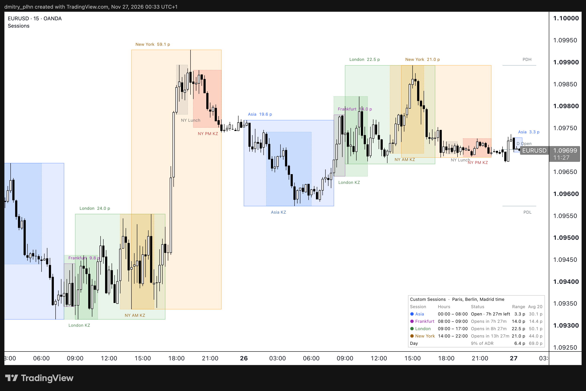

# Publishing on TradingView

How a release goes from this repository to the TradingView community library.

## What is published now

| | |
| --- | --- |
| Page | <https://www.tradingview.com/script/aK5XyDPb-Sessions-Killzones-Opening-Range-and-Dashboard-with-Auto-DST/> |
| Title | Sessions, Killzones, Opening Range and Dashboard with Auto DST |
| Author | [dmitry_plhn](https://www.tradingview.com/u/dmitry_plhn/) |
| Access | Public, open-source: everyone can add it to a chart and read the code on the page. It is the code of this repository. |
| Code | Version 4.4.0 — the file at the tag `v4.4.0` |
| First published | 2026-11-27, from version 4.4.0 |
| Categories | Multi-timeframe · Pivot points and levels |
| Tags | `sessions`, `killzones`, `forex` |
| Picture | `OANDA:EURUSD`, 15 minutes, the settings listed under [The chart is the picture](#the-chart-is-the-picture) |
| Earlier page | <https://www.tradingview.com/script/ticv4Yo6-Custom-Sessions-Indicator/> — see [The first page](#the-first-page) |

The description on that page is the text in [Description](#description) below; the release notes of each update
will follow it there.

## Before you publish

- [ ] `python3 tools/check.py` passes.
- [ ] The compile check shows zero errors and zero warnings (see [TESTING.md](TESTING.md)).
- [ ] The chart matrix in [TESTING.md](TESTING.md) is complete and logged.
- [ ] `VERSION` in the script, the README badges and `CHANGELOG.md` show the new version.
- [ ] The release is tagged in git: `git tag -a vX.Y.Z -m "vX.Y.Z"`.

## The chart is the picture

TradingView takes the publication picture from the chart that is open when you press **Publish script**, and it
takes a new one with every update. Prepare the chart first:

- one symbol, this indicator only, no other indicators and no drawings — moderators reject cluttered pictures;
- a liquid symbol and an intraday timeframe on which the sessions are easy to read (`OANDA:EURUSD`, 15 minutes);
- the settings of the table below: session labels, killzones and the dashboard show at a glance what the script
  does, and the description says that a new user gets the four session boxes only;
- two or three days on screen;
- the chart legend shown, so the symbol, the timeframe and the name of the script are on the picture — the
  publishing rules ask for all three.

Keeping a separate chart layout for this makes the picture repeatable.



`OANDA:EURUSD`, 15 minutes, two and a half days on screen, the chart legend shown. Changed from the defaults, and
named in the description:

| Group | Input | Value |
| --- | --- | --- |
| ③ Session display | Box fill transparency | `88` |
| ③ Session display | Border transparency | `55` |
| ③ Session display | Label | `Name + range` |
| ⑤ Killzones | Show killzones | on |
| ⑤ Killzones | Style | `Box` |
| ⑤ Killzones | Box fill transparency | `80` |
| ⑥ Previous day / week / month | Previous day high / low | on |
| ⑦ Opening prices | Day open | on |
| ⑩ Dashboard | Show dashboard | on |
| ⑩ Dashboard | Position | `Bottom right` |
| ⑩ Dashboard | Hours on my clock | on |

An update takes a new picture unless *Don't update the chart* is ticked: apply these settings first, or tick it.

## First publication

1. Open the script in the Pine Editor and **Save** it as `Custom Sessions Indicator`.
2. Open the prepared chart and add the saved script to it.
3. Press **Publish script** and choose **Public**, then the visibility: **Open-source** shows the code to everyone,
   **Protected** hides it. This indicator is published as open-source. Neither choice can be changed later.
4. Fill in the form with the texts below, tick the House Rules box and publish.

### Title

```
Sessions, Killzones, Opening Range and Dashboard with Auto DST
```

62 characters; the longest titles in the search are 64. The script declares the same title in `indicator()`, and
`tools/check.py` keeps it within the limit. The indicator search lists at most 50 scripts for a query, the most
boosted first, and it found this script by the words of its title only. A new script has no boosts, so the title
is made of words that few titles combine: on 2026-11-27 the search returned 7 scripts for `sessions dashboard`,
8 for `sessions opening range`, 14 for `sessions DST` and 28 for `sessions killzones`, against the full 50 for
`sessions` alone.

### Description

The publishing rules ask a description to explain what the script does, how it works, how to use it and why it
is original, in plain English and without links to other sites. The description field is plain text. The text of
the publication:

```
This indicator maps the trading day on an intraday chart: sessions, killzones, the levels they leave behind, an opening range and a dashboard, all in one settings panel. Every session is written in the local time of its own city, so daylight saving time takes care of itself.

WHY IT IS DIFFERENT
Many session indicators ask for one timezone for all sessions. Europe and the United States change their clocks on different dates, and for one to three weeks the boxes sit an hour off. Here every session row has a city: London 08:00-16:00 is 8 to 16 o'clock in London and follows London's daylight saving time, Tokyo follows Tokyo's clock, New York follows New York's. Nothing has to be retyped when the clocks change. If you prefer to type the hours as you see them on your chart, set a row to "My time".

WHAT IT SHOWS
- Sessions: 5 rows. Asia, Frankfurt, London and New York are on; a fifth row, Sydney, is off. Name, hours, city and colour are editable. A session is drawn as a box, a full-height background, both or hidden, with an optional label (name, range in price, ticks, pips or percent), an open line and a midline.
- Session high / low levels: when a session ends, its high and low stay on the chart until price trades through them.
- Killzones: 5 more rows with a clock and a style of their own. Asia, London, NY AM, NY Lunch and NY PM by default, written in New York time.
- Previous day / week / month high and low.
- Opening prices: day, week, month, midnight and one custom time.
- Opening range: the range of a chosen window with extended lines, a midline, projections and a marker on the first close outside the range.
- Day separators and weekday labels.
- Dashboard: which session is open, the time left or the time to the open, the current range against its average, the day range against the average daily range and, if you tick it, the hours of every session on your own clock.

HOW IT WORKS
A session is the set of bars whose opening time falls inside its window, read on the clock of its city; its high and low are tracked bar by bar. A new run of a session is recognised by its calendar date, so sessions are also correct on regular-hours charts and may be up to 24 hours long. A session level is broken when a later bar trades beyond it. Previous day, week and month values come from the higher timeframe with a one-bar offset, so historical bars never use data from their own future. An opening range breakout is a bar that closes outside the range. Label text is adjusted for contrast against the chart background, so it stays readable on light and dark themes.

The modules live in one script on purpose: killzones, levels, the opening range and the dashboard read the same session engine and the same clocks, so they cannot disagree about when a session starts or ends.

HOW TO USE IT
Add the indicator to a chart of 60 minutes or lower. Out of the box it draws only the four session boxes. Everything else is off and is switched on group by group in the settings. Pick your timezone in "My timezone" and tick "Hours on my clock" to read every session on your own clock. The chart above shows the indicator with session labels, killzones, the previous day high and low, the day open and the dashboard switched on.

LIMITATIONS
Sessions, killzones and the opening range need an intraday chart. The dashboard follows the wall clock and does not know about weekends and holidays. Session averages depend on the bars loaded on the chart. TradingView keeps the newest 500 lines, labels and boxes of a script, so a long history is trimmed. An indicator cannot read the timezone of your chart, which is why "My timezone" is a setting.

This script is a charting tool, not financial advice.
```

### Category and tags

- Categories: **Multi-timeframe** and **Pivot points and levels**.
- Tags: `sessions`, `killzones`, `forex`.

## Updating a published script

1. Open the saved script in the Pine Editor (**Open → My scripts**).
2. Replace its code with the new version and **Save**.
3. Open the prepared chart, so the update gets a clean picture. The saved script itself must be on it: an
   indicator added from the publication does not count, and TradingView then offers to add the saved one. Remove
   the other copy, so the picture shows the indicator once.
4. Press **Publish script → Update existing script**.
5. Choose `Sessions, Killzones, Opening Range and Dashboard with Auto DST` in the list of published scripts. The list opens after you type a few letters of the
   name. Tick *Don't update the chart* unless the picture settings are applied.
6. Write the release notes: the version, then the changes of the matching `CHANGELOG.md` section in plain text.
7. On the next page keep **Public** and **Open**, tick the House Rules box and press **Publish new version**.
   The form remembers the last choice, so read both before pressing.

An update must describe what changed; the matching `CHANGELOG.md` section does that. Publish an update when the code
changes, not to edit the page: the release notes are added under the first description, which stays as it is.

An update does not change charts by itself. An indicator that is already on a chart, added from the publication
or from the saved script, stays on the version it was added with until it is removed and added again. The new
version is the one that gets added from then on — with one catch: the Indicators dialog keeps its Favorites list
in the browser's cache, version included, so a browser that opened the dialog before the update can go on adding
the previous version. A favourite already in that cache is not requested again, and the cache is written anew at
every opening of the dialog; it is dropped only after 24 hours without being written, on sign-out, or when the
site data is cleared. Someone who opens the dialog every day therefore keeps getting the old version from
*Favorites* until one of those happens. To check what the service itself serves, read
`https://pine-facade.tradingview.com/pine-facade/versions/<pine id>`; the pine id of this publication starts with
`PUB;46c4`. A copy pasted from this
repository into someone's own Pine Editor does not change until they paste the new file.

## The first page

The indicator was first published on 2026-11-25 as *Custom Sessions Indicator*, protected, at
<https://www.tradingview.com/script/ticv4Yo6-Custom-Sessions-Indicator/>, and updated there up to version 4.3.1. A description cannot be edited after the first 15 minutes, and that
one stopped matching the script: it listed a session VWAP that was parked in 2.0.0 and named a timezone setting that
was removed in 4.0.0. For an issue that updates cannot fix, TradingView's *Tips for script authors* give one way
out: publish a corrected version and ask the script moderators to hide the old one. The page above is that
corrected version. The moderators were asked on 2026-11-27, in a private message to the `PineCoders` account, to
hide the first page. It gets no more updates.

Before the public page the same form was published once as **Private**: a private publication can be edited and
deleted at any time, and it showed the title, the description and the picture exactly as the public page has them.
It was deleted afterwards.

## Rules worth remembering

- A publication can be edited or deleted for 15 minutes. After that the title, the description, the privacy
  (public or private) and the visibility (open-source, protected or invite-only) are final, the page cannot be
  deleted, and only updates with release notes are possible. An update can change the code, the picture and the
  tags.
- A public open-source script cannot be made private later.
- The description, the release notes, the title, the picture and the code may not carry links or references to
  other websites or to social media, and may not ask for boosts, comments or followers. For that reason neither the
  publication nor the script links to this repository, while the repository links to the publication.
- A closed-source description must also say why the code is hidden. Editors' picks are chosen from public
  open-source scripts only.
- New publications are limited to 5 public scripts in 24 hours and 15 in 30 days; updates do not count.
- Moderators hide scripts that duplicate existing ones without adding anything; the description should say what is
  different here.
- The copyright line of a published script names the TradingView account that publishes it.

Read the current [House Rules](https://www.tradingview.com/house-rules/) and
[Script Publishing Rules](https://www.tradingview.com/support/solutions/43000590599/) before publishing — they change.
