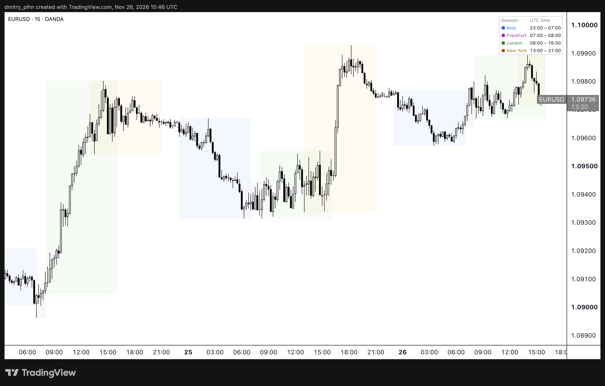
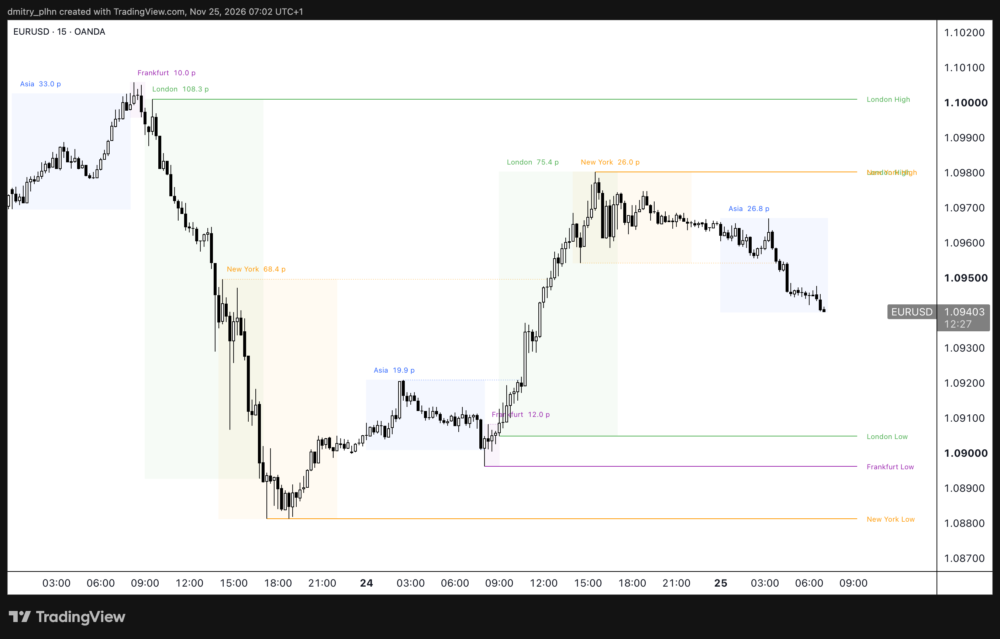
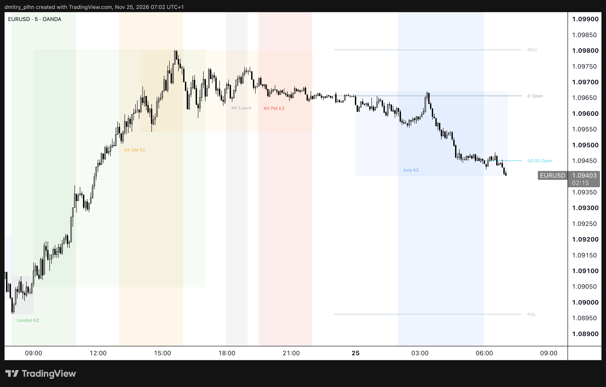
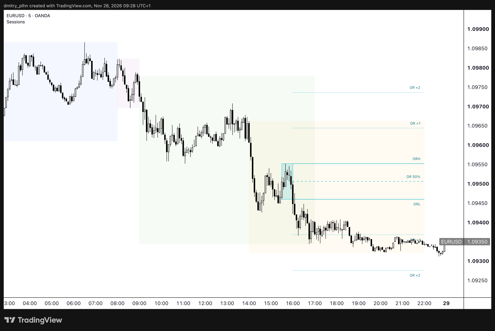
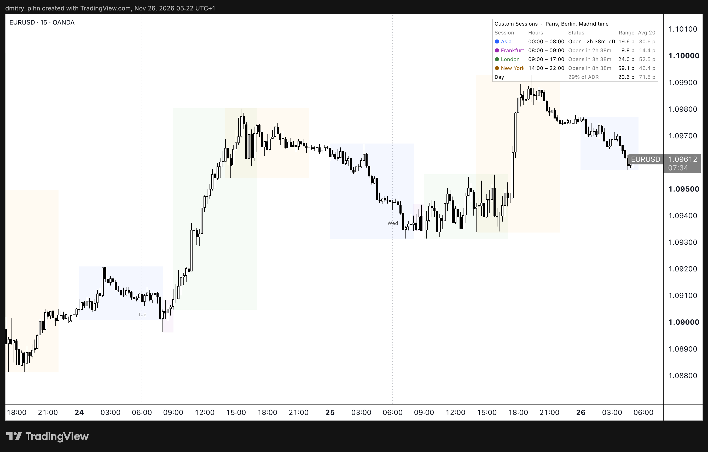

# Settings reference

Every input of the indicator, in the order of the settings panel. Inputs without a visible title sit on the same row
as the titled input before them.

> **Tip.** Hover the ⓘ icon next to an input in TradingView to read the same explanation without leaving the chart.

With every input at its default the chart shows the four main sessions and a small table of their hours:

The table has one line per session: its name and its hours on your own clock. The chart of the picture is set to
UTC, which is also the default of *① General → My timezone*, so the hours match the time axis. The other pictures
of this page, except the dashboard one, were taken with *⑩ Hours on my clock* off.

## ① General

| Input | Default | What it does |
| ------- | --------- | -------------- |
| History, days (0 = all) | `20` | Drawings older than this many days are skipped. `0` draws the whole loaded history. |
| Hide sessions above, minutes | `60` | Sessions, killzones and the opening range are hidden on chart timeframes above this value. |
| Level labels offset, bars | `5` | How many bars to the right of the last bar the level lines end. Their labels sit at that end, so keep the right margin of the chart at least this wide. |
| My timezone | `UTC` | The timezone your own chart shows — the clock in its bottom right corner. TradingView does not tell an indicator which one it is, so pick it here. The hours table on the chart then shows every session on your clock, and it changes as soon as another city is picked. It is also the timezone of every clock set to `My time`. Sessions are drawn in the right place whatever is chosen here. |

## ② Sessions

Five rows. Each row is: checkbox · name · hours · city. Under them sit the colours of the five rows, in the same
order, and one line that says how the hours are read.

| Input | Default | What it does |
| ------- | --------- | -------------- |
| Hours are local: 08:00 is 8 o'clock in the row's city | on | On: the hours of every row are the local time of the city in that row. That is why every row can start at 08:00: it is 8 o'clock in Tokyo, in Frankfurt, in London and in New York, four different moments on your chart. London `0800-1600` follows London's daylight saving time. Off: every row is read in *① General → My timezone*, whatever its city says, so the hours are typed as you see them on your chart. |

The chart draws every session on its own clock, so nothing has to be converted; the hours table shows the result.

| Slot | Name | Hours | City | On |
| ------ | ------ | ------- | ------ | ---- |
| 1 | Asia | `0800-1600` | `Tokyo` | yes |
| 2 | Frankfurt | `0800-0900` | `Frankfurt` | yes |
| 3 | London | `0800-1600` | `London` | yes |
| 4 | New York | `0800-1600` | `New York` | yes |
| 5 | Sydney | `0800-1600` | `Sydney` | no |

Asia, London, New York and Sydney are the 08:00 – 16:00 working day of their city. Frankfurt is the hour before
London opens. Default colours: Asia blue, Frankfurt purple, London green, New York orange. Every slot can be
renamed and retimed, so the fifth one doubles as a spare.

Cities: `Sydney`, `Tokyo`, `Hong Kong`, `Singapore`, `Shanghai`, `Mumbai`, `Dubai`, `Frankfurt`, `London`,
`New York`, `Chicago`, `UTC`, `Exchange` and `My time`. `Exchange` follows the symbol. `My time` reads the hours of
the row in *① General → My timezone*: type them as you see them on your chart.

Hours may cross midnight and may be up to 24 hours long (`1800-1800` restarts every day at 18:00).

## ③ Session display

| Input | Default | What it does |
| ------- | --------- | -------------- |
| Style | `Box` | `Box` frames the session range. `Background` shades the whole height of the chart. `Box + background` does both. `Hidden` keeps the session active for levels and the dashboard without drawing it. |
| Box fill transparency | `95` | 0 is solid, 100 is invisible. |
| Background transparency | `92` | Same scale, for the `Background` style. |
| Border transparency | `100` | Same scale, for the box border. The default draws no border; lower it to get one. |
| Border | `Solid`, `1` | Line style and width of the box border. |
| Label | `Hidden`, `Left` | The caption above the session: `Name + range`, `Name`, `Range` or `Hidden`, and where it sits. Off by default, so a fresh chart shows only the boxes. |
| Range unit | `Auto` | Unit of every range in labels and in the dashboard: `Price`, `Ticks`, `Pips` or `Percent`. `Auto` uses pips on forex and price elsewhere. |
| Open line | off | A dotted line at the opening price of the session. |
| Midline (50%) | off | A dashed line at the middle of the session range. It moves while the range grows. |

*③ Style = `Background`: every session shades the whole height of the chart. EURUSD on 15 minutes.*

## ④ Session high / low levels

| Input | Default | What it does |
| ------- | --------- | -------------- |
| Extend session high / low until broken | off | When a session ends, its high and low stay as lines. A high is broken by a higher high, a low by a lower low. |
| Broken levels | `Keep, faded` | `Keep, faded` stops the line at the breaking bar and dims it. `Remove` deletes it. |
| Max levels on chart | `12` | The oldest level is removed when this number is exceeded. |

*③ Label = `Name + range` and ④ Extend session high / low until broken, EURUSD on 15 minutes. The dotted lines
are levels that price has already traded through.*

## ⑤ Killzones

The windows are written in the local time of the *Clock* above them — `New York` by default, the clock killzones
are usually quoted in — and the chart draws them on its own clock.

| Input | Default | What it does |
|-------|---------|--------------|
| Show killzones | off | Master switch for all five rows. |
| Clock | `New York` | The city whose local time the windows below are written in. Same list as for a session row, `Exchange` and `My time` included. |

| Slot | Name | Window |
| ------ | ------ | -------- |
| 1 | Asia KZ | `2000-0000` |
| 2 | London KZ | `0200-0500` |
| 3 | NY AM KZ | `0700-1000` |
| 4 | NY Lunch | `1200-1300` |
| 5 | NY PM KZ | `1330-1600` |

| Input | Default | What it does |
| ------- | --------- | -------------- |
| Style | `Background` | Same choices as for sessions. |
| Box fill transparency | `88` | Used by the `Box` styles. |
| Background transparency | `90` | Used by the `Background` styles. |
| Label | `Name`, `Left` | Caption content and position. Killzone captions sit below the zone, so they do not collide with session captions above it. |

## ⑥ Previous day / week / month

| Input | Default | What it does |
| ------- | --------- | -------------- |
| Previous day high / low | off | Lines labelled `PDH` and `PDL`. |
| Previous week high / low | off | Lines labelled `PWH` and `PWL`. |
| Previous month high / low | off | Lines labelled `PMH` and `PML`. |
| Keep past periods | off | Keeps the lines of earlier days, weeks and months. Also applies to *⑦ Opening prices*. |

A period is shown only on chart timeframes lower than the period itself.

## ⑦ Opening prices

| Input | Default | Label on the chart |
| ------- | --------- | -------------------- |
| Day open | off | `D Open` |
| Week open | off | `W Open` |
| Month open | off | `M Open` |
| Midnight open (00:00) | off | `00:00 Open` — the first bar of the calendar day on the clock below |
| Custom open (hour, minute) | off, `8`, `30` | `08:30 Open` — the bar that opens at this time |
| Midnight and custom clock | `New York` | — the city whose local time those two opens use |

Day, week and month follow the trading calendar of the symbol. Midnight and the custom time follow the clock under
them.

*⑤ Show killzones, ⑥ Previous day high / low, ⑦ Day open and Midnight open, EURUSD on 5 minutes.*

## ⑧ Opening range

| Input | Default | What it does |
| ------- | --------- | -------------- |
| Show opening range | off | Master switch. |
| Window | `0930-1000` | The window in which the range is measured, written in the local time of the clock below. |
| Clock | `New York` | The city whose local time the window is written in. `Exchange` follows the symbol. |
| Colour | cyan | Colour of the box, the lines and the markers. |
| Extend for, hours | `6.0` | How long the lines keep extending after the window closes. |
| Midline | on | A dashed line at the middle of the range. |
| Projection 1 × | `1.0` | Lines at one range above the high and below the low. `0` turns them off. |
| Projection 2 × | `0.0` | A second pair of projections. |
| Breakout markers | on | A triangle on the first bar that closes outside the range, once per side. |

*⑧ Show opening range with Projection 2 × = `2`, EURUSD on 5 minutes.*

## ⑨ Time tools

| Input | Default | What it does |
|-------|---------|--------------|
| Day separators | off | A dotted vertical line at the first bar of each calendar day on the clock below. |
| Weekday labels | off | `Mon`, `Tue`, … below that bar. |
| Day starts at midnight in | `New York` | The city at whose midnight a new day starts for the two tools above. |

## ⑩ Dashboard

| Input | Default | What it does |
| ------- | --------- | -------------- |
| Show dashboard | off | Master switch. |
| Position | `Top right` | Corner or side of the chart. |
| Text size | `Small` | Size of the table text. |
| Average length | `20` | Number of completed sessions and days behind the `Avg` column. |
| Day range row | on | Adds the day range and its share of the average daily range. |
| Hours on my clock | on | Shows the hours of every session in *① General → My timezone*. With the dashboard off it is a small table of its own: session · hours on your clock, with enabled killzones listed under the sessions. With the dashboard on it is the *Hours* column. |

Columns: session name · hours on your own clock · status (`Open · 2h 05m left` or `Opens in 5h 03m`) · current or
latest range · average range. The first line names the timezone the hours are shown in.

*⑨ Day separators and Weekday labels, ⑩ Show dashboard, ① My timezone = `Paris, Berlin, Madrid`, EURUSD on 15 minutes
with the chart set to the same timezone.*

## ⑪ Style

| Input | Default | What it does |
| ------- | --------- | -------------- |
| Text size | `Small` | Size of every label on the chart. |
| Dashboard text follows the chart theme | on | Dark text on light charts, light text on dark charts. |
| Dashboard text colour | light grey | Used when the option above is off. |
| Level lines | `Solid`, `1` | Style and width of session levels, previous highs and lows, and opening prices. |
| Level labels | on | Text at the right end of each level line. |
| Price in level labels | off | Appends the price to the label. |
| Hide levels farther than, × ADR (0 = never) | `0.0` | Levels farther from the last price than this many average daily ranges are not drawn. Use it when a distant weekly or monthly level squeezes the candles. Session levels fold back to the bar where they formed. |
| Level labels position | `At the line end` | `At the line end` prints the text over the right end of the line — under it for lows — inside the chart, where the price scale cannot cut it off. `After the line` prints it to the right of the line; that needs a right margin wide enough for the whole text. |
| Label text adapts to the chart background | on | A label takes the colour of its line or zone. When this is on, a colour that would be hard to read on the chart background is darkened on a light chart and lightened on a dark one until its contrast reaches 4.5 : 1 — for the text only: captions, level labels and the session names in the dashboard. Lines and zones keep their colour. Switch it off to print text in the exact colour. |
