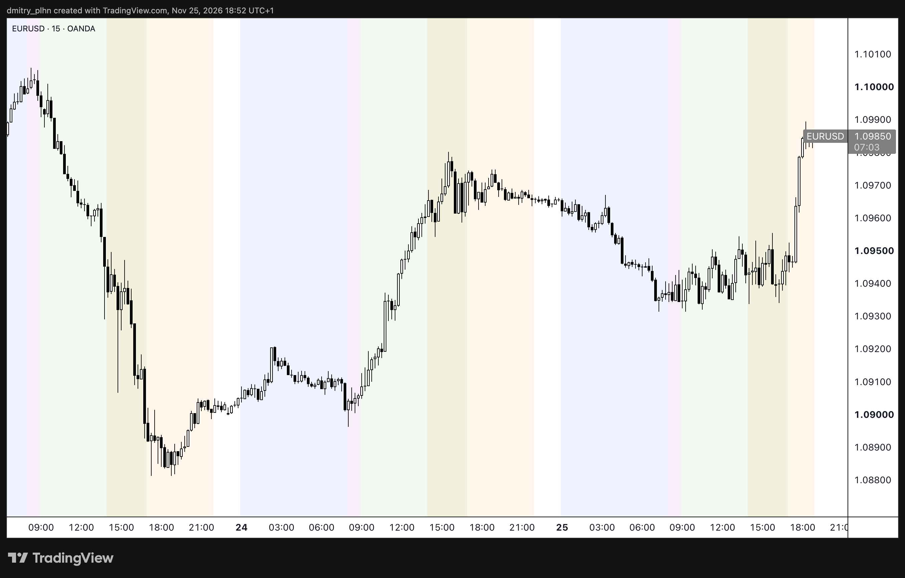

# Settings reference

Every input of the indicator, in the order of the settings panel. Inputs without a visible title sit on the same row
as the titled input before them.

> **Tip.** Hover the ⓘ icon next to an input in TradingView to read the same explanation without leaving the chart.

With every input at its default the chart shows the four main sessions and nothing else:

## ① General

| Input | Default | What it does |
| ------- | --------- | -------------- |
| History, days (0 = all) | `20` | Drawings older than this many days are skipped. `0` draws the whole loaded history. |
| Hide sessions above, minutes | `60` | Sessions, killzones, the opening range and the initial balance are hidden on chart timeframes above this value. |
| Level labels offset, bars | `5` | How many bars to the right of the last bar the level lines end. Their labels sit at that end, so keep the right margin of the chart at least this wide. The lines of the opening range and of the initial balance end there too while they extend. |
| My timezone | `Paris, Berlin, Madrid` | The timezone your own chart shows — the clock in its bottom right corner. TradingView does not tell an indicator which one it is, so pick it here. It is used in two places: the hours table (*⑩ Dashboard → Hours on my clock*), which shows every session on your clock, and every clock set to `My time`. Sessions are drawn in the right place whatever is chosen here. |

*My timezone* offers `Honolulu`, `Los Angeles`, `Denver`, `Chicago`, `Mexico City`, `New York, Toronto`,
`Bogota, Lima`, `Sao Paulo, Buenos Aires`, `UTC`, `London, Lisbon`, `Paris, Berlin, Madrid`, `Lagos`,
`Athens, Kyiv`, `Johannesburg`, `Istanbul, Moscow, Riyadh`, `Dubai`, `Karachi`, `Mumbai`, `Dhaka`,
`Bangkok, Jakarta`, `Singapore, Hong Kong`, `Tokyo, Seoul`, `Sydney`, `Auckland` and `Exchange`, the timezone of
the symbol. Pick the entry whose clock is yours: it follows the daylight saving time of the cities it names.

## ② Sessions

Five rows. Each row is: checkbox · name · hours · city. Under them sit the colours of the five rows, in the same
order, and one line that says how the hours are read.

| Input | Default | What it does |
| ------- | --------- | -------------- |
| Hours are local: 08:00 is 8 o'clock in the row's city | on | On: the hours of every row are the local time of the city in that row. That is why every row can start at 08:00: it is 8 o'clock in Tokyo, in Frankfurt, in London and in New York, four different moments on your chart. London `0800-1600` follows London's daylight saving time. Off: every row is read in *① General → My timezone*, whatever its city says, so the hours are typed as you see them on your chart. |

The chart draws every session on its own clock, so nothing has to be converted. Tick *⑩ Dashboard → Hours on my
clock* to read the result in a small table.

| Slot | Name | Hours | City | On |
| ------ | ------ | ------- | ------ | ---- |
| 1 | Asia | `0800-1600` | `Tokyo` | yes |
| 2 | Frankfurt | `0800-0900` | `Frankfurt` | yes |
| 3 | London | `0800-1600` | `London` | yes |
| 4 | New York | `0800-1600` | `New York` | yes |
| 5 | Sydney | `0800-1600` | `Sydney` | no |

Asia, London, New York and Sydney are the 08:00 – 16:00 working day of their city. Frankfurt is the hour before
London opens. Default colours: Asia blue, Frankfurt purple, London green, New York orange, Sydney teal. Every slot
can be renamed and retimed, so the fifth one doubles as a spare.

Cities: `Sydney`, `Tokyo`, `Hong Kong`, `Singapore`, `Shanghai`, `Mumbai`, `Dubai`, `Frankfurt`, `London`,
`New York`, `Chicago`, `UTC`, `Exchange` and `My time`. `Exchange` follows the symbol. `My time` reads the hours of
the row in *① General → My timezone*: type them as you see them on your chart.

Hours may cross midnight and may be up to 24 hours long (`1800-1800` restarts every day at 18:00).

## ③ Session display

| Input | Default | What it does |
| ------- | --------- | -------------- |
| Style | `Box` | `Box` frames the session range. `Background` shades the whole height of the chart. `Box + background` does both. `Hidden` draws neither: the label, the open line and the midline still show when they are on, and the session stays active for the levels and the dashboard. |
| Box fill transparency | `95` | 0 is solid, 100 is invisible. |
| Background transparency | `92` | Same scale, for the `Background` styles. |
| Border transparency | `100` | Same scale, for the box border. The default draws no border; lower it to get one. |
| Border | `Solid`, `1` | Line style of the box border — `Solid`, `Dashed` or `Dotted` — and its width, 1 to 4. |
| Label | `Hidden`, `Left` | The caption above the session: `Name + range`, `Name`, `Range` or `Hidden`, and where it sits: `Left`, `Center` or `Right`. Off by default, so a fresh chart shows only the boxes. |
| Range unit | `Auto` | Unit of every range in labels and in the dashboard: `Price`, `Ticks`, `Pips` or `Percent`. `Auto` uses pips on forex and price elsewhere. Pips are printed as `24.0 p`, ticks as `240 t`, percent as `0.22%`. |
| Open line | off | A dotted line at the opening price of the session, in the colour of the session. |
| Midline (50%) | off | A dashed line at the middle of the session range, in the colour of the session. It moves while the range grows. |

*③ Style = `Background`: every session shades the whole height of the chart. EURUSD on 15 minutes.*

## ④ Session high / low levels

| Input | Default | What it does |
| ------- | --------- | -------------- |
| Extend session high / low until broken | off | When a session ends, its high and low stay as lines. A high is broken by a higher high, a low by a lower low. |
| Broken levels | `Keep, faded` | `Keep, faded` stops the line at the breaking bar, makes it dotted and dims it, and takes its label away. `Remove` deletes the line. |
| Max levels on chart | `12` | The oldest level is removed when this number is exceeded. |

A level is drawn in the colour of its session, from the bar that made the high or the low, and carries the name
of the session: `London High`, `London Low`. Its look is set in *⑪ Style*.

*③ Label = `Name + range` and ④ Extend session high / low until broken, EURUSD on 15 minutes. The dotted lines
are levels that price has already traded through.*

## ⑤ Killzones

The windows are written in the local time of the *Clock* above them — `New York` by default, the clock killzones
are usually quoted in — and the chart draws them on its own clock.

| Input | Default | What it does |
|-------|---------|--------------|
| Show killzones | off | Master switch for all five rows. |
| Clock | `New York` | The city whose local time the windows below are written in. Same list as for a session row, `Exchange` and `My time` included. |

| Slot | Name | Window |
| ------ | ------ | -------- |
| 1 | Asia KZ | `2000-0000` |
| 2 | London KZ | `0200-0500` |
| 3 | NY AM KZ | `0700-1000` |
| 4 | NY Lunch | `1200-1300` |
| 5 | NY PM KZ | `1330-1600` |

Each row is: checkbox · name · window · colour. Default colours: Asia KZ blue, London KZ green, NY AM KZ orange,
NY Lunch grey, NY PM KZ red. A row is drawn when its own checkbox and *Show killzones* are both ticked.

| Input | Default | What it does |
| ------- | --------- | -------------- |
| Style | `Background` | Same choices as for sessions. A killzone box has a thin dotted border. |
| Box fill transparency | `88` | Used by the `Box` styles. |
| Background transparency | `90` | Used by the `Background` styles. |
| Label | `Name`, `Left` | Caption content and position. Killzone captions sit below the zone, so they do not collide with session captions above it. |

## ⑥ Previous day / week / month

| Input | Default | What it does |
| ------- | --------- | -------------- |
| Previous day high / low | off | Lines labelled `PDH` and `PDL`. |
| Previous week high / low | off | Lines labelled `PWH` and `PWL`. |
| Previous month high / low | off | Lines labelled `PMH` and `PML`. |
| Keep past periods | off | Keeps the lines of earlier days, weeks and months. Also applies to *⑦ Opening prices*. |

Each row has its own colour next to the checkbox: grey for the day, yellow for the week, orange for the month. A
period is shown only on chart timeframes lower than the period itself. The lines kept by *Keep past periods* are
fainter than the current ones.

## ⑦ Opening prices

| Input | Default | Label on the chart |
| ------- | --------- | -------------------- |
| Day open | off | `D Open` |
| Week open | off | `W Open` |
| Month open | off | `M Open` |
| Midnight open (00:00) | off | `00:00 Open` — the first bar of the calendar day on the clock below |
| Custom open (hour, minute) | off, `8`, `30` | `08:30 Open` — the bar that opens at this time |
| Midnight and custom clock | `New York` | — the city whose local time those two opens use |

Day, week and month follow the trading calendar of the symbol. Midnight and the custom time follow the clock under
them. Each row has its own colour next to the checkbox. The day, week and month opens are shown on chart
timeframes lower than their period, like the levels of *⑥*; the midnight and the custom open need an intraday
chart.

*⑤ Show killzones, ⑥ Previous day high / low, ⑦ Day open and Midnight open, EURUSD on 5 minutes.*

## ⑧ Opening range and initial balance

Two ranges measured at the start of a session, each with its own switch. Both work the same way: a box while the
window runs, then lines from its high, its low and its middle, projections above and below, and a marker on the
first close outside. They can be shown together — a 30-minute opening range inside the first-hour initial balance
is a common pair.

### Opening range

| Input | Default | What it does |
| ------- | --------- | -------------- |
| Show opening range | off | Master switch. |
| Window | `0930-1000` | The window in which the range is measured, written in the local time of the clock below. |
| Clock | `New York` | The city whose local time the window is written in. `Exchange` follows the symbol. |
| Colour | cyan | Colour of the box, the lines and the markers. |
| Extend for, hours | `6.0` | How long the lines keep extending after the window closes. |
| Midline | on | A dashed line at the middle of the range. |
| Projection 1 × | `1.0` | Lines at one range above the high and below the low. `0` turns them off. |
| Projection 2 × | `0.0` | A second pair of projections. |
| Breakout markers | on | A triangle on the first bar that closes outside the range, once per side: under the bar for a close above the range, over the bar for a close below it. A breakout is looked for while the lines extend, that is for *Extend for, hours* after the window closes. |
| Size label | off | Prints the size of the range under its box and, once the window has closed, its share of the average of the last ranges: `OR  12.0 p · 85% of avg`. |

*⑧ Show opening range with Projection 2 × = `2`, EURUSD on 5 minutes.*

### Initial balance

The initial balance is the range of the first hour of the regular session: 09:30 to 10:30 in New York for US stocks
and index futures. It comes from the market profile, where the rest of the day is read against that first hour:
price that stays inside it, leaves it on one side or leaves it on both.

| Input | Default | What it does |
| ------- | --------- | -------------- |
| Show initial balance | off | Master switch. |
| IB window | `0930-1030`, `New York` | The window in which the initial balance is measured and the city whose local time it is written in. `Exchange` follows the symbol. For another market set its own first hour, for example `0800-0900` and `London`. |
| IB colour | pink | Colour of the box, the lines, the labels and the markers. |
| IB lines extend for, hours | `5.5` | How long the lines keep extending after the window closes. 5.5 hours after 10:30 is the New York close at 16:00. |
| IB midline | on | A dashed line at the middle of the initial balance. |
| IB extensions × | `0.5`, `1.0`, `0.0` | Three pairs of lines above the high and below the low, as multiples of the size of the initial balance: `0.5` is half a range away, `1.0` a whole range. `0` turns a pair off. |
| IB breakout markers | on | A triangle on the first bar that closes outside the initial balance, once per side, while the lines extend. |
| IB size label | on | Prints the size of the initial balance over its box and, once the window has closed, its share of the average of the last days: `IB  42.0 p · 78% of avg`. |

The size label tells a narrow first hour from a wide one. Many traders expect price to leave a narrow initial
balance more easily and to stay inside a wide one more often; it is a tendency, not a rule, and the indicator only
shows the number.

### What both ranges share

- **Lines.** The high and the low are solid lines, the midline is dashed and the projections or extensions are
  dotted.
- **Labels.** With *⑪ Style → Level labels* on, the lines of the latest range carry their names at the right end:
  `ORH`, `ORL`, `OR 50%`, `OR ×1` and `IBH`, `IBL`, `IB 50%`, `IB ×0.5`, `IB ×1`. *Price in level labels* adds the
  price. When the two ranges share a high or a low — the high of the first half hour is often the high of the first
  hour — the names share one label, `ORH · IBH`, instead of two printed over each other.
- **Line end.** While the lines extend they end *① General → Level labels offset, bars* to the right of the last
  bar, like every other level line, and never later than their *Extend for* time.
- **Past days.** The opening range keeps all its lines. The initial balance keeps its box, its high and its low;
  the midline and the extensions stay for the latest day only, which keeps the chart readable and leaves room
  within TradingView's limit of 500 lines.
- **Average.** The average behind `% of avg` and behind the dashboard is taken over the last
  *⑩ Dashboard → Average length* ranges, from the bars loaded on the chart.
- **Timeframes.** A range is drawn up to *① General → Hide sessions above, minutes* and only when the bars of the
  chart can measure its window: the window has to be a whole number of bars long and has to start where a bar
  starts. A 1-hour chart whose bars open on the hour cannot measure 09:30 – 10:30, so nothing is drawn there; on
  30, 15, 5 and 1 minutes it is.

## ⑨ Time tools

| Input | Default | What it does |
| ------- | --------- | -------------- |
| Day separators | off | A dotted vertical line at the first bar of each calendar day on the clock below. Its colour is on the same row. |
| Weekday labels | off | `Mon`, `Tue`, … below that bar. |
| Day starts at midnight in | `New York` | The city at whose midnight a new day starts for the two tools above. |

Both tools are drawn on every intraday timeframe, also above the limit of *① General → Hide sessions above*.

## ⑩ Dashboard

| Input | Default | What it does |
| ------- | --------- | -------------- |
| Show dashboard | off | Master switch. |
| Position | `Top right` | Corner or side of the chart: `Top left`, `Top center`, `Top right`, `Middle left`, `Middle right`, `Bottom left`, `Bottom center` or `Bottom right`. |
| Text size | `Small` | Size of the table text: `Tiny`, `Small`, `Normal` or `Large`. |
| Average length | `20` | Number of completed sessions and days behind the `Avg` column. |
| Day range row | on | Adds the day range and its share of the average daily range. |
| Hours on my clock | off | Shows the hours of every session in *① General → My timezone*. With the dashboard off it is a small table of its own, in the corner chosen in *Position*: session · hours on your clock, with enabled killzones listed under the sessions. With the dashboard on it is the *Hours* column. |

Columns: session name · hours on your own clock · status (`Open · 2h 05m left` or `Opens in 5h 03m`) · current or
latest range · average range. The first line names the timezone the hours are shown in. The last row, `Day`, shows
the range of the current day, its share of the average daily range (`62% of ADR`) and that average.

The opening range and the initial balance, when they are on, have a row each under the sessions. Their status is
`Forming · 23m left` while the window runs; `Inside`, `Broken up`, `Broken down` or `Broken both ways` while their
lines extend; and `Opens in 17h 30m` after that. A range is broken by a bar that closes outside it.

The hours table of its own is shown on the timeframes where sessions are drawn. The dashboard stays on every
timeframe; above the session limit the ranges of the sessions show `—`.

*⑨ Day separators and Weekday labels, ⑩ Show dashboard and Hours on my clock, EURUSD on 15 minutes with the chart
set to Paris time, the default of ① My timezone.*

## ⑪ Style

| Input | Default | What it does |
| ------- | --------- | -------------- |
| Text size | `Small` | Size of every label on the chart: `Tiny`, `Small`, `Normal` or `Large`. |
| Dashboard text follows the chart theme | on | Dark text on light charts, light text on dark charts. |
| Dashboard text colour | light grey | Used when the option above is off. |
| Level lines | `Solid`, `1` | Style — `Solid`, `Dashed` or `Dotted` — and width, 1 to 4, of session levels, previous highs and lows, and opening prices. |
| Level labels | on | Text at the right end of each level line, the lines of the opening range and of the initial balance included. |
| Price in level labels | off | Appends the price to the label. |
| Hide levels farther than, × ADR (0 = never) | `0.0` | Levels farther from the last price than this many average daily ranges are not drawn. Use it when a distant weekly or monthly level squeezes the candles. Session levels fold back to the bar where they formed. The average daily range is taken over *⑩ Dashboard → Average length* days. |
| Level labels position | `At the line end` | `At the line end` prints the text over the right end of the line — under it for lows — inside the chart, where the price scale cannot cut it off. `After the line` prints it to the right of the line; that needs a right margin wide enough for the whole text. |
| Label text adapts to the chart background | on | A label takes the colour of its line or zone. When this is on, a colour that would be hard to read on the chart background is darkened on a light chart and lightened on a dark one until its contrast reaches 4.5 : 1 — for the text only: captions, level labels and the session names in the dashboard. Lines and zones keep their colour. Switch it off to print text in the exact colour. |

## Data Window and the Style tab

Two things live outside the settings groups above.

- **Data Window.** The indicator plots the running high and low of every session row: `Session 1 high`,
  `Session 1 low` … `Session 5 high`, `Session 5 low`, numbered like the rows of *② Sessions*. They draw nothing
  on the chart: open TradingView's *Data Window* and move the cursor over a bar to read them. A value is shown
  while the bar is inside the session and is empty outside it.
- **Style tab.** The full-height bands of the `Background` styles are listed on the *Style* tab of the settings as
  `Session 1 background` … `Session 5 background` and `Killzone 1 background` … `Killzone 5 background`. The
  colour of a band comes from its row and its strength from *Background transparency*; unticking an entry on that
  tab hides that one band.
